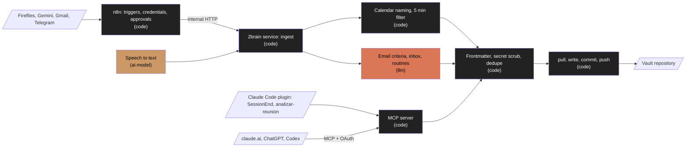

# 2brain-logic: brief

Status: approved  |  Date: 2026-10-31  |  Project type: automation, ai

## Problem
People who work across many sources (meetings, email, chat ideas, AI coding sessions) lose
decisions, figures and code that worked because nothing collects and files them; we want every
source to land in an Obsidian vault in Git, classified and linked, searchable from any AI client
over MCP, with no manual work beyond approving what is ambiguous, and installable by anyone.

## Users
- Primary: the owner of one vault (the reference install is the project author's, on a Hetzner
  server that already runs n8n). Daily use: several meetings, a few dozen emails, ideas by
  Telegram, Claude Code sessions.
- Secondary: anyone who installs it on their own Docker host with their own vault repository
  and n8n instance. One owner per install.

## Why now
The author already pays for and uses every input tool (Fireflies, Gmail, Notion, Claude) and has
an n8n server with spare capacity (about 2.5 GB RAM free). MCP is now supported by claude.ai,
ChatGPT and the coding CLIs, so one server can serve every client.

## Current workaround and its cost
Transcripts are uploaded by hand to Claude projects, decisions live in scattered chats, and
working commands are re-discovered. Fireflies keeps recordings only while the account allows it.
The cost is time spent searching and rework when a decision or a command is lost.

## Alternatives considered
| Option | Why not (or why yes) |
|---|---|
| Don't build | The source decision brief (2026-10-30) settled the need; the author loses context weekly |
| Buy / configure Smart Connections, Copilot for Obsidian | Query notes, but do not capture from meetings or email, and send notes to external services |
| Buy Notion AI, Mem, Reflect | Not Obsidian, not plain Markdown in Git, no open MCP server for every client |
| Approach A: thin n8n + tested service | Chosen: n8n keeps triggers, credentials and Telegram approvals; the logic lives in a TypeScript service with tests |
| Approach B: logic inside n8n nodes | Rejected: no tests, outside what the build harness can verify, hard to ship to other users |

## Recommendation
Go (approved decision brief, 2026-10-30), because the inputs and the server already exist, every
client now speaks MCP, and the logic is small and testable. Owner decision: installable by third
parties from milestone 1, not only for the author.

## System
- Input: n8n webhooks and schedules (Fireflies, Gemini transcripts, Gmail, Telegram), MCP calls
  from AI clients, the Claude Code plugin at session end.
- Processing: normalize, name meetings from the calendar, a few fixed LLM steps (email criteria,
  inbox classification, routines), validate frontmatter, scrub secrets, dedupe, git commit.
- Output: Markdown notes in the owner's vault repository; tasks to the owner's task tool through
  n8n.
- Workflow or agent: workflow, because every source follows a fixed path
  (docs/adr/0002-workflow-vs-agent.md).

## Core journeys (MVP)
1. An AI client (claude.ai) searches the vault and saves a note through MCP, authenticated.
2. A Claude Code session ends and its decisions and validated recipes land in the vault.
3. A new user runs the installer and reaches journey 1 on their own server.

## First milestone
- Features in build order: F0 walking skeleton, F1 vault core, F2 MCP server, F3 Claude Code
  plugin, F4 installer. Then F5 meetings (no LLM), F6 capture (Telegram, email), F7 routines.
- Success signal: a third party installs from scratch, following only the README, and saves a
  note from claude.ai.

## Non-functional requirements
- Memory: the service container runs under a 512 MB limit next to n8n on a 3.7 GB host.
- Text search over 10,000 notes answers in under 2 s (ripgrep).
- A vault write (pull, write, commit, push) completes in under 10 s on a healthy remote.
- LLM spend stays under the owner's cap (USD 20/month for the reference install).

## Constraints
- Deadline: none.
- Budget: Anthropic API USD 20/month; no new servers.
- Team and maintenance: the author, with the Rockbuilt harness.
- Integrations and credentials: GitHub (vault repository, deploy key or token), n8n API key,
  Anthropic API key; Fireflies, Google and Notion credentials stay inside n8n.

## Security and data
- Data stored: meeting transcripts and notes with personal and work data (personal), no payment
  data, no credentials (scrubbed before commit).
- Auth model: single owner per install; MCP behind OAuth 2.1.
- Secrets: environment variables (`.env` on the host, never committed).
- External input trusted: n8n requests on the internal network only, MCP requests after OAuth,
  LLM output always validated against a Zod schema before it touches the vault.

## Stack
| Layer | Choice | Version | Docs |
|---|---|---|---|
| Runtime | Node.js LTS | 24.22.2 | https://nodejs.org/docs/latest-v24.x/api/ |
| Language | TypeScript (strict) | 7.0.2 | https://www.typescriptlang.org/docs/ |
| HTTP | Hono + @hono/node-server | 4.13.14 / 2.1.5 | https://hono.dev/docs/ |
| MCP | @modelcontextprotocol/server (ADR 0013) | 2.4.0 | https://github.com/modelcontextprotocol/typescript-sdk |
| Validation | Zod | 4.6.7 | https://zod.dev |
| LLM | @anthropic-ai/sdk | 1.3.0 | https://docs.claude.com/en/api/client-sdks |
| Frontmatter | gray-matter | 4.0.3 | https://github.com/jonschlinkert/gray-matter |
| Search | ripgrep (image binary) | system | https://github.com/BurntSushi/ripgrep |
| Tests / lint | Vitest / Biome | 5.0.5 / 2.6.4 | https://vitest.dev, https://biomejs.dev |
| Deploy | Docker Compose | system | https://docs.docker.com/compose/ |
| Orchestrator | n8n (templates target) | 2.39.8 | https://docs.n8n.io |

Hosting: any Docker host; the reference install shares the n8n server and its Caddy proxy.

## Operation
- Tools: Claude Code
- Autonomy: auto
- Paid services approved: Anthropic API (USD 20/month)
- Nightly cloud routine: optional, set up by the owner (docs/CLOUD.md in the Rockbuilt repo)

## Key decisions
- Stack, because one typed language covers the service, MCP server, plugin and installer
  (docs/adr/0001-stack.md)
- Workflow, not agent (docs/adr/0002-workflow-vs-agent.md)
- Thin n8n, logic in the tested service (docs/adr/0003-thin-n8n.md)
- Meetings make zero LLM calls; analysis runs in the owner's subscription
  (docs/adr/0004-meetings-without-llm.md)
- Vault in its own repository, Git as storage and sync (docs/adr/0005-vault-in-git.md)
- Everything owner-specific comes from configuration (docs/adr/0006-configuration-driven.md)
- MCP never public without OAuth 2.1 (docs/adr/0007-mcp-auth.md)
- Deterministic secret scrub, nothing deleted from a vault (docs/adr/0008-vault-safety.md)
- Session capture through Claude Code's native SessionEnd hook (docs/adr/0009-session-end-hook.md)

## Out of scope
See docs/v2.md. Hard non-goals:
- Meeting analysis through the API.
- Storing tasks in the vault.
- Deploying from CI to anyone's server.

## Open items
- ADVISORY: deploy (default: manual `git pull` and `docker compose up -d --build` on the host,
  documented in the install guide; CI never deploys).
- ADVISORY: config location (default: `.2brain/config.yaml` in the vault root, mapping the
  owner's folder names and languages to the generic ones).
- ADVISORY: MCP tool names (default: English `search`, `read`, `save_note`, `save_recipe`,
  `recent`, `update_properties`).
- ADVISORY: git conflicts (default: keep both versions as `<note> (conflict YYYY-MM-DD).md` and
  alert; until Telegram exists, the alert is a log line).
- RESOLVED: OAuth implementation, built-in authorization server (docs/research/mcp-oauth/REPORT.md, ADR 0014).
- DEFERRED: speech-to-text provider benchmark (to the F6 spec).
- DEFERRED: whether the Fireflies API can rename and delete transcripts (to the F5 spec).
- DEFERRED: access to the author's work Gmail and Drive from the reference n8n (F5 and F6 specs,
  off the critical path).
