# Design: Vault core

Status: approved  |  Date: 2026-10-31  |  Requirements: ./requirements.md
ADRs: docs/adr/0010-ingest-bearer-token.md, docs/adr/0011-note-write-operations.md, docs/adr/0012-vault-config-mapping.md
Approved by: the owner's standing instruction in the build session (2026-10-31), see requirements.md. No cost items.

Every item below cites the requirement IDs it serves. Anything without an R reference does not
belong here.

## Overview
Every request except `GET /health` passes a bearer-token check (R1). Inside the existing serialized write queue, each operation pulls first with a conflict handler that never leaves a rebase in progress (R8.1, R8.2), loads the vault configuration from the freshly pulled clone (R2), validates the frontmatter against it (R3), scrubs secrets (R4), performs one of three operations (create, patch, archive) with idempotency rules (R5, R6, R7), commits, and pushes with retries (R8.3, R8.4). A default configuration and vault template ship with the product, and `init-vault` seeds a new vault (R9). Compose gains a healthcheck (R10).

## Architecture

```mermaid
flowchart LR
  IN[/"HTTP request (n8n, plugin)"/] --> AUTH["Bearer token check<br/>(code)"]
  AUTH --> SHAPE["Request schema and path rules<br/>(code)"]
  SHAPE --> Q["Serialized write queue<br/>(code)"]
  Q --> SYNC["Pull with conflict handler<br/>(code)"]
  SYNC --> CFG["Load vault config<br/>(code)"]
  CFG --> FM["Frontmatter validator<br/>(code)"]
  FM --> SCRUB["Secret scrubber<br/>(code)"]
  SCRUB --> OP["create / patch / archive<br/>(code)"]
  OP --> PUSH["Commit and push with retry<br/>(code)"]
  PUSH --> OUT[/"Vault repository"/]
  classDef code fill:#222,color:#fff
  class AUTH,SHAPE,Q,SYNC,CFG,FM,SCRUB,OP,PUSH code
```


| Node / component | Kind | Responsibility | Location | Serves |
|---|---|---|---|---|
| Bearer token check | code | Constant-time compare of `Authorization: Bearer`, skip `/health`, never log the value | src/auth/ingest-token.ts | R1.1, R1.2, R1.4 |
| Env loader | code | `INGEST_TOKEN` required, at least 32 characters, errors name the variable only | src/config/env.ts | R1.3 |
| Request schema and path rules | code | Zod bodies for the three operations; path rules extended with leading `:` and Windows-unsafe names | src/vault/note-schema.ts | R8.5, R6, R7 |
| Write queue | code | Existing promise-chain mutex, now wrapping every operation | src/vault/vault.ts | R5, R6, R7, R8 |
| Pull with conflict handler | code | `pull --rebase`; on failure abort, rebuild local changes on top of the remote, conflict copies, commit | src/git/sync.ts | R8.1, R8.2 |
| Vault config | code | Strict Zod schema, defaults, mapping of canonical names, re-read after each pull | src/config/vault-config.ts, src/config/defaults.ts | R2.1 to R2.4, R9.1 |
| Frontmatter validator | code | Required properties, allowed type, area and date, type folder | src/vault/validate.ts | R3.1 to R3.4, R6.1 |
| Secret scrubber | code | Ordered rule list, replacement, counts | src/vault/scrub/rules.ts, src/vault/scrub/index.ts | R4.1 to R4.4 |
| Source index | code | `source_id` to path map, rebuilt when HEAD changes, reads only the frontmatter block | src/vault/source-index.ts | R5.2 |
| Operations | code | create (idempotent), patch (set, append, immutable body), archive (move) | src/vault/operations.ts | R5, R6, R7 |
| Push with retry | code | 3 retries, injectable waits (1, 2, 4 s); `push_pending` | src/git/sync.ts | R8.3, R8.4 |
| Routes | code | `POST /notes`, `PATCH /notes`, `POST /notes/archive`, error mapping | src/server/app.ts | R1, R3 to R8 |
| init-vault CLI | code | Copy the template without overwriting, report skipped files | src/cli.ts, vault-template/ | R9.2 |
| Compose healthcheck | code | `node -e` fetch of `/health` inside the container | compose.yaml | R10.1 |

## Workflow vs agent
Workflow, because every operation has a fixed path and no model is involved (docs/adr/0002-workflow-vs-agent.md). (R1 to R10)

## Data model / schema impact
- `.2brain/config.yaml` (in the vault), version 1 (R2, R9.1):

```yaml
version: 1
vault:
  archive_folder: archive        # R7.1
  inbox_folder: inbox
properties:                      # canonical name -> owner property name (R2.2)
  type: type
  area: area
  date: date
  source: source
  source_id: source_id
areas: [personal, work]          # R3.2; owner values
sources: []                      # optional allow-list for `source`; empty means any non-empty string
types:                           # canonical type -> owner value, folder, body rule (R3.2, R3.4, R6.3)
  meeting:  { value: meeting,  folder: "{area}/meetings", immutable_body: true }
  analysis: { value: analysis, folder: "{area}/meetings" }
  project:  { value: project,  folder: "{area}/projects" }
  resource: { value: resource, folder: "{area}/resources" }
  email:    { value: email,    folder: "{area}/resources" }
  topic:    { value: topic,    folder: "topics" }
  person:   { value: person,   folder: "people" }
  recipe:   { value: recipe,   folder: "recipes" }
  idea:     { value: idea,     folder: "inbox" }
  daily:    { value: daily,    folder: "daily" }
  review:   { value: review,   folder: "reviews" }
```

  The schema is strict (unknown keys rejected, R2.3); the skeleton test that pinned "unknown keys ignored" changes accordingly. `folder` is optional per type; without it any safe path is accepted (R3.4). Defaults live in src/config/defaults.ts and a unit test asserts that vault-template/.2brain/config.yaml parses to exactly the same object (R2.1, R9.1).
- Notes: no new stored fields beyond the configured properties. A conflict copy is a normal note file (R8.1). An archived note keeps its frontmatter unchanged (R7.1).
- Retention and deletion: nothing is deleted; archive is a move (R7.3).

## Interfaces and contracts
```ts
// Every route except GET /health requires: Authorization: Bearer <INGEST_TOKEN>   (R1.1)
// POST /notes             { path, frontmatter: Record<string, unknown>, body: string }
// PATCH /notes            { path, set?: Record<string, unknown>, append?: string }  (at least one)
// POST /notes/archive     { path }
type Ok = {
  ok: true; path: string; commit: string | null; // null when unchanged
  unchanged?: true; redactions?: { rule: string; count: number }[];
};
type Err = { ok: false; error: string; [detail: string]: unknown };
```

| Endpoint / function | Input | Output | Errors | Serves |
|---|---|---|---|---|
| `POST /notes` | path, frontmatter, body | 201 Ok; 200 Ok with `unchanged` | 400 invalid_body, invalid_frontmatter, wrong_folder, unsafe_path; 401; 409 note_exists, duplicate_source; 502 push_pending; 503 config_invalid; 500 scrub_failed, write_failed | R3, R4, R5, R8 |
| `PATCH /notes` | path, set, append | 200 Ok | 400; 401; 404 note_not_found; 409 immutable_body; 502; 503; 500 | R6, R4.1 |
| `POST /notes/archive` | path | 200 Ok with the new path | 400; 401; 404; 409 already_archived, archive_target_exists; 502; 503 | R7 |
| `GET /health` | none | 200 `{ ok: true }` | none | R1.2, R10.1 |
| `scrub(text)` | string | `{ text, hits: Map<rule, count> }` | throws ScrubError | R4 |
| `loadVaultConfig(dir)` | vault dir | VaultConfig | ConfigInvalidError(file, keyPath) | R2 |
| `syncBeforeWrite(dir)` | vault dir | `{ conflicts: number }` | GitError | R8.1, R8.2 |
| `pushWithRetry(dir, waits)` | vault dir | `{ pushed: boolean, commit }` | none (returns pushed false) | R8.3, R8.4 |
| `init-vault <dir>` | target dir | copied and skipped lists on stdout | exit 1 when the target is a file | R9.2 |

Commit messages: `2brain: add <path>`, `2brain: update <path>`, `2brain: archive <path> -> <new path>`, `2brain: keep conflicting versions (<n> files)`.

## Error handling
| Failure | Scope (per item / fatal) | Response | Retry (backoff, max) | Serves |
|---|---|---|---|---|
| Missing or wrong token | per request | 401, no git command | none | R1.1 |
| Token missing or short at startup | fatal | exit 1, message names `INGEST_TOKEN` | none | R1.3 |
| Invalid config | per request | 503 `config_invalid` with file and key path | none (fixed by a vault commit) | R2.3 |
| Rebase conflict on pull | per request | abort, conflict copies, commit, continue the request | none | R8.1, R8.2 |
| Push rejected or network error | per request | retry, then 502 `push_pending` with the commit | 3 retries, 1 s, 2 s, 4 s (injectable for tests) | R8.3 |
| Scrubber exception | per request | 500 `scrub_failed`, nothing written | none | R4.4 |
| Any git error elsewhere | per request | 500 `write_failed`, GitError redaction | none | preserved behavior |

- Idempotency: identical content at the path is a no-op 200 (R5.1); a known `source_id` is a 409 with the existing path (R5.2); a patch that changes nothing is a no-op (R6.5). Every operation ends with a push attempt when the local branch is ahead, so a pending commit leaves with the next request (R8.4).
- Concurrency limit: one operation at a time per vault (existing queue), because git operations on one clone cannot run in parallel. (R5, R6, R7, R8)
- Cleanup: the conflict handler never leaves `.git/rebase-merge` or `.git/rebase-apply`; a failed write that created a file before the commit removes that untracked file so a retry is not a false 409. (R8.2, R5.1)

## Security considerations
- Authn: bearer token on every route but `/health`, compared with `timingSafeEqual` over equal-length buffers; the token and the header never reach logs (R1). The API stays on the internal network (ADR 0007).
- Input validation: Zod at the boundary, path rules (R8.5), frontmatter rules (R3); `GIT_LITERAL_PATHSPECS=1` in every git call (R8.5).
- Secrets: `INGEST_TOKEN` from env only; the scrubber runs before any write and logs rule names and counts only (R4.3).
- Personal data: notes are personal data in the owner's private repository; conflict copies and archived notes stay in it (R7, R8).
- New dependencies: none.
- Security gate required: yes (auth, scrub, external input to files and git).

## Testing strategy
| Level | What | Covers |
|---|---|---|
| unit | token middleware with a fake writer; env loader; config schema and mapping; validator; scrub rules with positive and negative fixtures per rule (tests/fixtures/scrub/); path rules; operations with a fake git; compose.yaml parsed for the healthcheck; template parsed and grep-checked | R1, R2.1, R2.2, R3, R4, R6.3 to R6.5, R7.2, R7.3, R8.5, R9.1, R9.3, R10.1 |
| integration | real bare remote (tests/helpers/git-fixture.ts): config change applied after pull; idempotent create; duplicate source; patch set and append; archive move; conflict built with `cloneElsewhere`; push failure with injected zero waits and a remote made read-only; pending push delivered later; init-vault on empty and partial directories | R2.3, R2.4, R5, R6.1, R6.2, R7.1, R8.1 to R8.4, R9.2 |

## Risk and cost
- Tier C at build time: src/auth/** (auth), src/vault/scrub/** (sensitive path), Dockerfile (copy vault-template into the image), compose.yaml (healthcheck), .env.example (`INGEST_TOKEN`). Approved by the owner's standing instruction.
- New dependencies: none. Paid services: none. Monthly cost: none.

## Alternatives considered
- mTLS or a signed request (HMAC) instead of a bearer token: stronger replay protection, but n8n HTTP nodes and the plugin carry a header trivially and the API never leaves the internal network (ADR 0010).
- ripgrep for the source index: fast, but not present on every CI runner; the frontmatter-only scan cached by HEAD is fast enough for the brief's 10,000 notes (R5.2).
- LLM-based redaction: rejected in ADR 0008.
- `git merge` instead of rebase: creates merge commits on every sync and still needs a conflict policy (ADR 0005).

## Open questions
None. Defaults chosen under the owner's standing instruction are recorded in ADRs 0010 to 0012.
