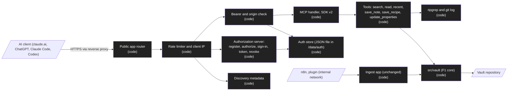

# Design: MCP server with OAuth

Status: approved  |  Date: 2026-10-31  |  Requirements: ./requirements.md
ADRs: docs/adr/0013-mcp-sdk-v2.md, docs/adr/0014-built-in-authorization-server.md, docs/adr/0015-public-mcp-app.md
Research: docs/research/mcp-oauth/REPORT.md (candidate C2 won, 92 of 100)

Every item below cites the requirement IDs it serves. Anything without an R reference does not
belong here.

## Overview
The service process starts a second Hono app, the public app, on `MCP_PORT` when `PUBLIC_BASE_URL` is set (R1). It holds a built-in single-owner OAuth 2.1 authorization server (discovery, dynamic registration, authorize with an owner passphrase, token, revoke) and the MCP endpoint, served by the MCP SDK v2 web-standard handler behind a bearer check (R2 to R7). Clients and grants live in a small JSON store in a data volume, never in the vault (R5.5). The six MCP tools call the same `src/vault/` functions the ingest API uses, so validation, scrub, dedupe and git handling are shared (R8, R9). The ingest app is unchanged and stays on the internal network (existing behavior).

## Architecture


| Node / component | Kind | Responsibility | Location | Serves |
|---|---|---|---|---|
| Public env | code | `PUBLIC_BASE_URL`, `MCP_PORT`, `OWNER_PASSPHRASE_HASH`, `ALLOWED_REDIRECT_HOSTS`, `AUTH_STORE_DIR`, `TRUST_PROXY_HOPS`; errors name the variable only | src/config/env.ts | R1.2, R1.3, R3.2, R5.5, R7.2 |
| Public app router | code | Mounts only `/mcp`, OAuth routes and `/.well-known/*`; 404 otherwise; every URL from `PUBLIC_BASE_URL` | src/mcp/app.ts | R1.1, R1.4 |
| Startup | code | Starts the public app only when configured; one log line otherwise | src/index.ts | R1.2 |
| Rate limiter | code | Fixed-window counters per route and client key (`rateKey`: IPv4-mapped IPv6 as IPv4, other IPv6 grouped by /64) plus a global ceiling on `register` (30 per hour) and `signin` (30 per minute); `Retry-After`; client IP from socket or the configured hop | src/auth/rate-limit.ts | R7.1, R7.2, R4.5 |
| Discovery | code | RFC 9728 (both paths) and RFC 8414 documents | src/auth/oauth/metadata.ts | R2.2, R2.3 |
| Registration | code | RFC 7591 parsing with Zod, redirect allowlist, client cap (evicts the oldest grantless client older than 24 h), secret generation | src/auth/oauth/register.ts | R3.1 to R3.4 |
| Authorize and sign-in | code | Request checks, PKCE S256, resource default, sign-in page, scrypt check, attempt lockout | src/auth/oauth/authorize.ts, src/auth/owner.ts | R4.1 to R4.6 |
| Token and revoke | code | Code exchange, refresh rotation with grant revocation, RFC 7009 revoke, client auth (`none`, post, basic) | src/auth/oauth/token.ts | R5.1 to R5.4 |
| Auth store | code | Clients and grants in one JSON file, atomic write (temp file then rename), SHA-256 hashes only, expiry cleanup | src/auth/oauth/store.ts | R5.5, R5.6 |
| Bearer and origin check | code | Token lookup by hash, expiry, revocation, audience; 401 with `WWW-Authenticate`; 403 on a foreign `Origin` | src/auth/oauth/bearer.ts | R2.1, R6.1 to R6.3 |
| MCP handler | code | SDK v2 server with the six tools, stateless Streamable HTTP, JSON responses | src/mcp/server.ts | R6.1 |
| Read tools | code | `search` (ripgrep `--fixed-strings -i --json`, globs `*.md`, excludes `.git` and the archive folder, 2 s timeout), `read` (path rules and realpath inside the vault), `recent` (`git log --name-only --since`) | src/mcp/tools/read.ts, src/git/index.ts | R8.1 to R8.4 |
| Write tools | code | `save_note`, `save_recipe` (builds the `recipe` type note), `update_properties`, all through `src/vault/` and the shared error mapping | src/mcp/tools/write.ts | R9.1 to R9.5 |
| Shared error mapping | code | One table from vault errors to codes and detail fields, used by the ingest routes and the tools | src/server/errors.ts | R9.4 |
| Passphrase CLI | code | `hash-passphrase` reads stdin, checks length, prints `scrypt$<N>$<r>$<p>$<salt base64url>$<key base64url>` | src/cli.ts, src/auth/owner.ts | R10.1, R10.2 |

## Workflow vs agent
Workflow. Every step is deterministic code; the AI client is the caller, not part of the service. No LLM call in this feature (R8, R9).

## Data model / schema impact
New file, outside the vault: `<AUTH_STORE_DIR>/auth.json` (R5.5).
```ts
type AuthStore = {
  version: 1;
  clients: Record<string, {           // key: client_id (random, 32 bytes base64url)
    secretHash?: string;              // SHA-256 hex, absent for method "none"
    authMethod: "none" | "client_secret_post" | "client_secret_basic";
    redirectUris: string[]; name?: string; createdAt: string;
  }>;
  grants: Record<string, {            // key: grant id
    clientId: string; resource: string; createdAt: string; revoked: boolean;
    accessHash: string; accessExpiresAt: string;
    refreshHash: string; refreshExpiresAt: string;
    usedRefreshHashes: string[];      // rotation history, for reuse detection (R5.3)
  }>;
};
```
Codes and sign-in attempts stay in memory (60 seconds and 15 minutes). A restart drops pending sign-ins only. Expired grants are removed on each write. No change to the vault or its config.

New env vars (all in `.env.example`): `PUBLIC_BASE_URL`, `MCP_PORT` (3001), `OWNER_PASSPHRASE_HASH`, `ALLOWED_REDIRECT_HOSTS`, `AUTH_STORE_DIR` (`/data/auth`), `TRUST_PROXY_HOPS` (0). Dockerfile: `NODE_OPTIONS=--max-old-space-size=192` (research: RSS levels off near 110 MB with a capped heap). compose.yaml: a named volume for `/data/auth` owned by `node`; no port is published to the host, the proxy reaches `MCP_PORT` over the existing `n8n` network (the proxy route itself is F4).

## Interfaces and contracts
```ts
// Public app (MCP_PORT), all URLs from PUBLIC_BASE_URL
// GET  /.well-known/oauth-protected-resource[/mcp]   RFC 9728
// GET  /.well-known/oauth-authorization-server       RFC 8414
// POST /register   RFC 7591 JSON
// GET  /authorize  query: client_id, redirect_uri, response_type=code, code_challenge, code_challenge_method=S256, state?, resource?
// POST /authorize  form: the same fields plus passphrase (same origin)
// POST /token      form: grant_type=authorization_code|refresh_token, ...
// POST /revoke     form: token, token_type_hint?
// POST /mcp        Authorization: Bearer <access token>, MCP JSON-RPC
type ToolResult = { ok: true; [field: string]: unknown } | { ok: false; error: string; [detail: string]: unknown };
```

| Tool | Input (Zod) | Output | Errors | Serves |
|---|---|---|---|---|
| `search` | `query` (1 to 200 chars), `limit?` | `{ results: { path, title, line, snippet }[] }` | `search_failed`, `search_timeout` | R8.1, R8.4 |
| `read` | `path` | `{ path, frontmatter, body }` | `unsafe_path`, `note_not_found` | R8.2 |
| `recent` | `days?`, `limit?` | `{ notes: { path, title, type, date }[] }` | `git_failed` | R8.3 |
| `save_note` | `path`, `frontmatter`, `body` | create outcome | every `POST /notes` error code | R9.1, R9.4 |
| `save_recipe` | `title`, `area`, `problem`, `solution`, `source?` | create outcome | same | R9.2, R9.4 |
| `update_properties` | `path`, `set` | patch outcome | every `PATCH /notes` error code | R9.3, R9.4 |

`save_recipe` builds `recipes/<slug of title>.md` (the configured folder of the `recipe` type) with frontmatter type, area, today's date, source (`mcp` when absent) and title, and a body of `## Problem` and `## Solution` sections. `update_properties` needs the F1 PATCH path (F1 T13); its F2 task depends on that.

## Error handling
- OAuth errors use RFC 6749 and RFC 7591 codes; error descriptions are fixed strings, never Zod issue lists or request values (research: library A leaked raw Zod JSON) (R3.3, R4.3, R5.2).
- Errors that cannot be redirected safely (unknown client, unregistered redirect) are a 400 page, never a redirect (R4.2).
- Tool errors are tool results with `ok: false` and a code; unexpected exceptions become `internal_error` with no message; logs carry the code only (R9.4).
- Store writes are serialized through one promise chain and written to a temp file then renamed; a failed write leaves the old file and returns `server_error` (R5.5).
- An unreadable store at startup is fatal with the file name only (R5.6).
- `search` runs ripgrep with `execFile`, argument arrays, `--` before the query, a 2 s timeout and a 1 MiB output cap; a timeout returns `search_timeout` (R8.1, R8.4).
- Read tools pull before reading, through the same queue as writes, so a read sees the latest commit; a pull failure falls back to the local clone and says so in the result (`stale: true`) (R8.1 to R8.3).

## Security considerations
- Only one person can authorize: the owner passphrase, scrypt (N=2^15, r=8, p=1, random 16-byte salt), compared with `timingSafeEqual`; 5 wrong attempts per IP in 15 minutes locks that IP (R4.4, R4.5).
- Open registration cannot become a phishing path: redirect hosts are allowlisted at registration and matched exactly at authorize; the sign-in page shows the redirect host (R3.2, R4.1, R4.2).
- Clients never expire, so a few addresses could fill all 50 slots for good. At the cap, registration removes the oldest client that has no grant (live or revoked) and is more than 24 hours old, in the same write that stores the new one; if none qualifies it answers 400 (R3.4). An evicted client never had a grant, so no session is lost.
- Tokens are opaque random 32-byte values; only SHA-256 hashes are stored; access tokens are bound to the resource URL (RFC 8707) and expire in 1 hour; refresh tokens rotate and reuse revokes the grant (R5).
- Issuer and resource come from `PUBLIC_BASE_URL` only, so a forged `Host` cannot change advertised URLs (R1.4).
- Client IP for rate limits never trusts the leftmost `X-Forwarded-For` (research: library B was spoofable) (R7.2).
- `register` and `signin` also have a global ceiling that counts all clients together (`register` 30 per hour, `signin` 30 per minute), so rotating addresses cannot multiply the per-IP limits. Past a ceiling every request on that route gets 429 until the window ends: an attacker can block new registrations and sign-ins for a window (R7.1). `token` has no global ceiling: codes, tokens and secrets are 32-byte random values, and the per-key limit of 60 per minute bounds the cost.
- The public app has no route to the ingest API; the ingest token is never accepted on the public app (R1.1).
- Clickjacking and caching of the sign-in page: `X-Frame-Options: DENY`, `Cache-Control: no-store`, CSRF prevented by checking `Origin` on the POST and by PKCE binding (R4.6).
- `Origin` check on `/mcp` against DNS rebinding (R6.3).
- `read` resolves the real path and refuses anything outside the vault or in `.git` (R8.2).
- Every write goes through the F1 scrubber; read tools return vault content as stored (already scrubbed) (R9.1).
- `src/auth/**` is a Sensitive path: every task there is tier C with a security review.

## Testing strategy
| Level | What | Criteria |
|---|---|---|
| unit | metadata documents, registration rules, authorize checks, token rules, revoke, bearer check, origin check, rate limiter and client IP, error mapping, tool input schemas, no delete tool | R1.4, R2, R3, R4.2, R4.3, R4.5, R4.6, R5.1 to R5.4, R6.2, R6.3, R7, R9.4, R9.5 |
| integration | the public app started from `dist/index.js` with a temp store and a fixture vault: full flow with the SDK v2 client (discover, register, authorize with a passphrase, token, `tools/call`, refresh, revoke), restart keeps tokens, invalid store exits, 404 for ingest routes, each tool against a fixture vault, 10,000-note search timing, `hash-passphrase` | R1.1 to R1.3, R4.1, R4.4, R5.5, R5.6, R6.1, R8, R9.1 to R9.3, R10 |
| manual | claude.ai, Claude Code, Codex or ChatGPT against the public URL | R11 |

The flow test reuses the research client script (docs/research/mcp-oauth/shared/flow.mjs) as a starting point, rewritten in TypeScript under tests/.

## Risk and cost
- Tier C at build time: the dependency change (ADR 0013), everything under `src/auth/**` (Sensitive path), the Dockerfile and compose changes (Sensitive paths), and the new env vars.
- Cost: none. No paid service, no LLM call; the manual checks use the owner's existing accounts.

## Alternatives considered
| Option | Why not |
|---|---|
| `@modelcontextprotocol/sdk` 1.32.2 auth router (research A, 56) | Express only, `client_secret_basic` broken, rate limiter shares one bucket behind a proxy, maintenance line until about 2027-01 |
| `@hono/mcp` 0.3.5 (research B, 52) | Wrong `resource_metadata` URL, revoke returns 500, spoofable rate limiter, needs SDK v1 |
| Hand-rolled server on SDK v1 transport (research C1, 75) | Same server code, older transport and spec level, Express installed |
| External identity provider | Extra server or account for every installer, against the brief's constraints |
| Route exemptions in the ingest app | One app on two networks; a mistake in the exemption list exposes ingest |

## Open questions
None blocking. Deferred to docs/v2.md: scopes, CIMD, OpenID discovery, a second factor, consent memory.
