# Design: Claude Code plugin

Status: approved  |  Date: 2026-10-31  |  Requirements: ./requirements.md
ADRs: docs/adr/0016-session-capture-with-headless-claude.md (proposed), docs/adr/0009-session-end-hook.md, docs/adr/0007-mcp-auth.md, docs/adr/0012-vault-config-mapping.md

Every item below cites the requirement IDs it serves. Anything without an R reference does not
belong here.

Claude Code facts this design relies on (official docs, read 2026-10-31):

| # | Fact | Source |
|---|---|---|
| D1 | The manifest is `.claude-plugin/plugin.json`; `skills/`, `hooks/hooks.json` and `.mcp.json` sit at the plugin root, not inside `.claude-plugin/` | https://code.claude.com/docs/en/plugins-reference |
| D2 | `userConfig` options (types `string`, `number`, `boolean`, with `default`, `required`, `sensitive`) are prompted when the plugin is enabled; every option is exported to hook processes as `CLAUDE_PLUGIN_OPTION_<KEY>` | https://code.claude.com/docs/en/plugins-reference |
| D3 | Hook processes get `CLAUDE_PLUGIN_ROOT`, `CLAUDE_PLUGIN_DATA` (`~/.claude/plugins/data/<id>/`, kept across updates, deleted on uninstall) and `CLAUDE_PROJECT_DIR`; do not write state in `CLAUDE_PLUGIN_ROOT` | https://code.claude.com/docs/en/plugins-reference |
| D4 | SessionEnd input: common fields `session_id`, `transcript_path`, `cwd`, `hook_event_name`, plus `reason` (`clear`, `resume`, `logout`, `prompt_input_exit`, `other`); it cannot block exit | https://code.claude.com/docs/en/hooks |
| D5 | SessionEnd hooks share a 1.5 second budget; per-hook `timeout` can raise it up to 60 s, but "Timeouts set on plugin-provided hooks don't raise the budget"; `CLAUDE_CODE_SESSIONEND_HOOKS_TIMEOUT_MS` overrides it (a user setting, not something a plugin can rely on) | https://code.claude.com/docs/en/hooks |
| D6 | `async: true` hooks are killed at `claude -p` teardown; "If your hook's work must outlive a `claude -p` session, start a fully detached process from it" | https://code.claude.com/docs/en/hooks |
| D7 | Exec form (`command` plus `args`) spawns without a shell on every platform; on Windows the command must be a real executable, and `node` plus a script path works everywhere | https://code.claude.com/docs/en/hooks |
| D8 | Hook processes inherit the Claude Code process environment (minus `OTEL_*`) | https://code.claude.com/docs/en/hooks |
| D9 | `transcript_path` is a JSONL file written asynchronously; it may lag the last messages | https://code.claude.com/docs/en/hooks |
| D10 | `--bare` skips hooks, plugins and MCP discovery but never reads OAuth credentials: it needs `ANTHROPIC_API_KEY`, so it cannot run on the subscription | https://code.claude.com/docs/en/headless |
| D11 | Without `--bare`, `claude -p` loads hooks, plugins and MCP servers as an interactive session does, including the working directory's `.claude/settings.json` and `.mcp.json` | https://code.claude.com/docs/en/headless |
| D12 | `--tools ""` disables every built-in tool and does not affect MCP tools; `--allowedTools` uses permission rule syntax; `--permission-mode dontAsk` denies every call that would prompt; `--permission-prompts none` (v2.1.259 or later) denies unanswered prompts and tells Claude not to retry | https://code.claude.com/docs/en/cli-reference, https://code.claude.com/docs/en/headless |
| D13 | `--max-turns`, `--model` (aliases such as `sonnet`, `haiku`), `--output-format json` (fields `result`, `session_id`, `total_cost_usd`), `--json-schema` (result in `structured_output`, absent when the run did not produce it), `--no-session-persistence`, `--setting-sources`, `--append-system-prompt-file` | https://code.claude.com/docs/en/cli-reference, https://code.claude.com/docs/en/headless |
| D14 | Piped stdin is capped at 10 MB | https://code.claude.com/docs/en/headless |
| D15 | In `-p` mode an `ANTHROPIC_API_KEY` in the environment is always used when present; `ANTHROPIC_AUTH_TOKEN` and cloud provider variables rank above the subscription login | https://code.claude.com/docs/en/authentication |
| D16 | User-scoped MCP servers live in `~/.claude.json` and load in every project; local scope (the `claude mcp add` default) loads only in the project where it was added | https://code.claude.com/docs/en/mcp |
| D17 | A `claude -p` run cannot do the MCP OAuth flow; sign in first with `/mcp` or `claude mcp login <name>`; when a server needs auth during a run, Claude is told its tools are unavailable; tokens refresh automatically | https://code.claude.com/docs/en/mcp |
| D18 | MCP tools are named `mcp__<server>__<tool>`; a plugin-bundled server is `mcp__plugin_<plugin>_<server>__<tool>` | https://code.claude.com/docs/en/mcp |
| D19 | A marketplace is `.claude-plugin/marketplace.json` with `name`, `owner`, `plugins[]`; a relative source such as `./plugin` resolves from the marketplace root for a `github` marketplace source; `plugin.json` `version` controls updates | https://code.claude.com/docs/en/plugins/marketplace-reference, https://code.claude.com/docs/en/plugins-reference |
| D20 | `claude plugin validate <dir> --strict` turns warnings into failures | https://code.claude.com/docs/en/plugins-reference |

## Overview
When a Claude Code session ends, the plugin's SessionEnd hook (exec form, `node`) writes the
event to a job file and spawns a detached worker, then exits well inside the 1.5 second budget
(R2, D5, D6). The worker waits for the transcript to settle, skips trivial or already captured
sessions, builds a bounded digest of the transcript plus the project's `docs/progress.md`,
removes secret-shaped strings, and runs one `claude -p` session on the owner's subscription with
no built-in tools and only the brain MCP tools allowed (R3 to R6). That headless session calls
`vault_info`, then `save_note`, `save_recipe` and `update_properties` on the owner's
user-scoped MCP server, and returns a structured result that the worker logs locally (R7, R8).
The plugin also ships the `analizar-reunion` skill, which runs in the owner's interactive session
and uses the same MCP tools (R9). One small service change adds the read-only `vault_info` tool
and the canonical `session` type (R10).

## Architecture

```mermaid
flowchart LR
  CC[/"Claude Code session ends (SessionEnd JSON on stdin)"/] --> HOOK["session-end.mjs: guard, job file, detached spawn<br/>(code)"]
  HOOK --> Q[/"Job queue in CLAUDE_PLUGIN_DATA"/]
  HOOK -.->|"detached, no shell"| WK["capture-worker.mjs: lock, settle, skip, dedupe<br/>(code)"]
  Q --> WK
  WK --> DG["Digest: transcript JSONL + docs/progress.md, cap, pre-scrub<br/>(code)"]
  DG --> RUN["Headless runner: argv, env scrub, timeout<br/>(code)"]
  RUN -->|"stdin input, TWOBRAIN_CAPTURE=1"| HL["claude -p on the owner's subscription<br/>(llm)"]
  HL -->|"MCP + OAuth (owner's login)"| MCP["2brain MCP server: vault_info, search, read,<br/>save_note, save_recipe, update_properties<br/>(code)"]
  MCP --> VAULT[/"Vault repository (F1 write path: validate, scrub, dedupe, commit)"/]
  HL -->|"structured result"| RUN
  RUN --> LOG[/"logs/capture.log, state.json"/]
  OWNER[/"Owner asks: analyze my meeting"/] --> SK["analizar-reunion skill in the interactive session<br/>(llm)"]
  SK --> MCP
  classDef code fill:#222,color:#fff
  classDef aimodel fill:#c96,color:#000
  classDef llm fill:#d97757,color:#000
  class HOOK,WK,DG,RUN,MCP code
  class HL,SK llm
```


| Node / component | Kind | Responsibility | Location | Serves |
|---|---|---|---|---|
| Manifest | code | `name: 2brain`, `version`, `userConfig` (`area`, `server_name`, `model`, `min_user_prompts`, `note_language`, `enabled`) | plugin/.claude-plugin/plugin.json | R1.1, R1.3 |
| Marketplace | code | One entry `{ "name": "2brain", "source": "./plugin" }` | .claude-plugin/marketplace.json | R1.2 |
| Hook config | code | SessionEnd, exec form: `command: "node"`, `args: ["${CLAUDE_PLUGIN_ROOT}/scripts/session-end.mjs"]`, no matcher (all reasons) | plugin/hooks/hooks.json | R1.1, R2.6 |
| Hook | code | Recursion guard, `enabled` check, input validation, job file (mode 0600), detached spawn of the worker with `process.execPath`, exit 0; never prints | plugin/scripts/session-end.mjs | R2.1, R2.3 to R2.6, R3.2, R8.9 |
| Worker | code | Lock, queue drain, retries, settle wait, skip and dedupe rules, part numbering, logout deferral, state file | plugin/scripts/capture-worker.mjs, plugin/scripts/lib/queue.mjs, plugin/scripts/lib/state.mjs | R2.2, R4, R6.7, R8.1, R8.6, R8.9 |
| Transcript digest | code | Tolerant JSONL reader, prompt counting, digest with per-result cap, head and tail cut | plugin/scripts/lib/digest.mjs | R4.2, R5.1 to R5.3 |
| Progress reader | code | `docs/progress.md` under `cwd` only if a regular file whose real path stays inside `cwd`; first 20,000 characters; read-only | plugin/scripts/lib/progress.mjs | R5.4, R5.5 |
| Pre-scrub | code | Fixed regex list, `[redacted]`; a subset of the F1 rules, kept in the plugin because the plugin cannot import the service | plugin/scripts/lib/scrub.mjs | R5.6 |
| Headless runner | code | Resolves `claude`, skips when user settings define `apiKeyHelper`, builds argv and env, writes the input to stdin, 10 minute kill, parses JSON and `structured_output` | plugin/scripts/lib/headless.mjs | R3.1, R3.3, R5.7, R5.8, R6.1 to R6.6, R6.8, R8.2 to R8.5 |
| Capture prompt | llm | Instructions for the headless session: tools allowed, steps, note shape, recipe rule, people rule, no secrets, result schema | plugin/prompts/capture.md, plugin/prompts/result.schema.json | R7.1 to R7.8 |
| Logger | code | One line per event, rotation at 1 MiB | plugin/scripts/lib/log.mjs | R8.7, R8.8 |
| Meeting skill | llm | Generic meeting analysis over MCP | plugin/skills/analizar-reunion/SKILL.md | R9 |
| `vault_info` tool | code | Read-only description of the vault config | src/mcp/tools/info.ts, src/mcp/server.ts | R10.1, R10.2 |
| `session` type | code | Default type `session` in `{area}/sessions` | src/config/defaults.ts, vault-template/.2brain/config.yaml, vault-template/personal/sessions/README.md, vault-template/work/sessions/README.md | R10.3 |
| Owner guide | code | Install, settings, `claude mcp add --scope user`, sign-in, troubleshooting by log code | docs/GUIDE-plugin.md, docs/GUIDE-mcp.md (scope line) | R1.6, R8, R10.4 |

## Workflow vs agent
Hybrid, kept as close to a workflow as possible: the hook and worker are a fixed pipeline (R2 to
R6, R8), and one step is a bounded agentic run, because deciding what counts as a decision or a
validated recipe and phrasing it needs a model, and the model must call MCP tools to write
(R7). The path is fixed in the prompt: `vault_info`, optional `search` and `read` for people and
existing recipes, then saves, then the result. Risks of a pure workflow (worker writes through
the API): no write path exists from the owner's machine without the public MCP endpoint and its
OAuth, and the worker would need an MCP client and token storage. (ADR 0016) (R7)

- Instructions: summarize one finished session into the owner's vault; never paste secrets,
  credentials or environment values; never create person notes; save nothing when nothing is
  worth keeping; always end with the result object (R7.2 to R7.8).
- Tools: `vault_info`, `search`, `read` (read only, no approval); `save_note`, `save_recipe`,
  `update_properties` (write, pre-approved by `--allowedTools`; there is no delete or move tool,
  F2 R9.5). Every built-in tool is removed (`--tools ""`) and every other call is denied
  (`dontAsk`) (R6.1, R6.2).
- Memory: none. Each run sees one session's input; `--no-session-persistence` (R3.3).
- Stop condition and step budget: the result object, or 20 turns, or 10 minutes (R6.3, R6.6).
- Scorers: none automated (R7 criteria are `[manual]`, see Testing strategy).

## Data model / schema impact
- Vault config: new default type `session: { value: session, folder: "{area}/sessions" }` in
  src/config/defaults.ts and vault-template/.2brain/config.yaml; existing vaults whose config
  lists `types` add the line themselves (the install guide says so). Migration: none, the config
  is re-read after every pull (ADR 0012) (R10.3).
- Session note (written by the headless session through `save_note`, owner property names from
  `vault_info`) (R7.1, R7.2, R4.6, R4.7):
  ```yaml
  <type>: session            # the configured value of the session type
  <area>: <area setting>
  <date>: 2026-10-31         # date of the session's last transcript entry
  <source>: claude-code
  <source_id>: claude-code:<session id>[:<n>]
  project: <last segment of cwd>
  title: <short title>
  ```
  Body: `## Summary`, `## Decisions`, `## Open items`, `## Recipes` (wikilinks to the saved
  recipes), `## People` when any person note was updated.
- Plugin data directory `CLAUDE_PLUGIN_DATA` on the owner's machine, outside the vault (D3)
  (R4.4, R8.6 to R8.9):
  ```text
  queue/<epoch ms>-<session id>.json   job: { version: 1, event: <SessionEnd input>, attempts: 0, createdAt, area }  (area is resolved at hook time)
  failed/<same name>                   jobs that gave up
  state.json                           { version: 1, sessions: { <session id>: { lineage, prompts, parts, capturedAt } } }
  capture.lock                         { pid, startedAt }
  logs/capture.log, logs/capture.log.1
  ```
- Data retention and deletion: a job is deleted on success or skip; failed jobs stay 30 days then
  are deleted; state entries older than 180 days are pruned; everything goes with the plugin's
  uninstall (D3). Job files hold no transcript text, only the event (paths and ids); the digest is
  built in memory and only passed on stdin (R8.9, R5.7).

## Interfaces and contracts
```jsonc
// plugin/hooks/hooks.json (R1.1, R2.6)
{ "hooks": { "SessionEnd": [ { "hooks": [
  { "type": "command", "command": "node", "args": ["${CLAUDE_PLUGIN_ROOT}/scripts/session-end.mjs"] }
] } ] } }
```
```ts
// Headless invocation built by headless.mjs (R3.1, R3.3, R5.7, R6.1 to R6.5)
const server = settings.server_name;           // default "brain"
const tools = ["vault_info", "search", "read", "save_note", "save_recipe", "update_properties"]
  .map((t) => `mcp__${server}__${t}`);
const argv = [
  "-p",
  "--tools", "",
  "--allowedTools", tools.join(","),
  "--permission-mode", "dontAsk",
  "--permission-prompts", "none",
  "--model", settings.model,                   // default "sonnet"
  "--max-turns", "20",
  "--output-format", "json",
  "--json-schema", resultSchemaJson,           // plugin/prompts/result.schema.json
  "--append-system-prompt-file", `${pluginRoot}/prompts/capture.md`,
  "--setting-sources", "user",
  "--no-session-persistence",
];
// cwd: CLAUDE_PLUGIN_DATA; stdin: the input below; env: process.env minus ANTHROPIC_API_KEY,
// ANTHROPIC_AUTH_TOKEN, CLAUDE_CODE_USE_BEDROCK, CLAUDE_CODE_USE_VERTEX, CLAUDE_CODE_USE_FOUNDRY,
// plus TWOBRAIN_CAPTURE=1. spawn(claudePath, argv, { shell: false, windowsHide: true }).

// stdin input (plain text, built by the worker) (R5, R7.1)
// CAPTURE REQUEST
// area: <area>  language: <note_language>  date: <YYYY-MM-DD>  project: <name>
// source_id: claude-code:<session id>[:<n>]  part: <n>
// note path: <session folder for area>/<YYYY-MM-DD> <project> <id8>[ part <n>].md
//   (the worker gives the file name; the headless session joins it to the session type folder from vault_info)
// --- progress.md (first 20,000 characters) ---
// --- transcript digest ---

// Result schema (structured_output) (R7.8, R4.8, R8.4, R8.5)
type CaptureResult = {
  status: "saved" | "nothing_to_save" | "mcp_unavailable" | "session_type_missing" | "failed";
  session_note: string | null;      // vault path
  recipes: string[];                // vault paths
  people_updated: string[];         // vault paths
  already_saved: boolean;           // save_note answered unchanged or duplicate_source
  detail: string;                   // at most 120 characters, lowercase code words, no content
};

// vault_info MCP tool (R10.1, R10.2)
type VaultInfo = {
  areas: string[];
  properties: { type: string; area: string; date: string; source: string; source_id: string };
  types: { key: string; value: string; folder: string | null }[];
  archive_folder: string;
};

// Log line (R8.7)
// 2026-10-31T21:04:05.123Z 1a2b3c4d saved notes=work/sessions/2026-10-31 api 1a2b3c4d.md recipes=1
```

| Endpoint / function | Input | Output | Errors | Serves |
|---|---|---|---|---|
| `session-end.mjs` (stdin) | SessionEnd JSON | exit 0, job file, detached worker | logs `invalid_input`, `hook_error` | R2.1, R2.3, R2.4, R3.2 |
| `capture-worker.mjs <job dir>` | queued jobs | captures, state, log | logs every code in Error handling | R2.2, R4, R6, R8 |
| `buildDigest(lines, opts)` | JSONL lines | `{ text, userPrompts, lineage, lastDate }` | skips bad lines | R4.2, R5.1 to R5.3 |
| `preScrub(text)` | text | `{ text, count }` | none | R5.6 |
| `buildInvocation(settings, env, paths)` | settings, env | `{ argv, env, cwd }` | `not_configured` | R3.1, R6.1 to R6.5 |
| `vault_info` (MCP) | none | `VaultInfo` | `config_invalid` | R10.1, R10.2 |

## Error handling
| Failure | Scope (per item / fatal) | Response | Retry (backoff, max) | Serves |
|---|---|---|---|---|
| Hook input not JSON or missing fields | per event | log `invalid_input`, exit 0, no job | none | R2.3 |
| Any hook exception (data dir not writable, spawn fails) | per event | log `hook_error` if possible, exit 0; a stored job runs with the next worker | next session end | R2.4 |
| `TWOBRAIN_CAPTURE=1` or `enabled=false` | per event | exit 0 silently | none | R2.5, R3.2 |
| `TWOBRAIN_AREA` and `area` empty | per job | log `not_configured`, job kept | every session end, until 7 days | R8.1 |
| Transcript missing | per job | log `transcript_missing`, job deleted | none | R4.3 |
| Trivial or duplicate | per job | log `skipped_trivial` or `skipped_duplicate`, job deleted | none | R4.2, R4.5 |
| User settings define `apiKeyHelper` | per job | log `api_helper_present`, job deleted | none | R6.8 |
| Reason `logout` | per job | job kept, not counted as an attempt | with the next capture | R4.9 |
| `claude` not found | per job | log `claude_not_found`, job kept | next session end, max 3 attempts | R8.2 |
| Non-zero exit, bad JSON, no `structured_output` | per job | log `headless_failed exit=<n>` | next session end, max 3 attempts | R8.3 |
| Result `mcp_unavailable` | per job | log `mcp_unavailable`, job kept | next session end, max 3 attempts | R8.4, R11.3 |
| Result `session_type_missing` | per job | log `session_type_missing`, job kept | next session end, max 3 attempts | R8.5 |
| Result `already_saved` | per job | log `already_saved`, state updated, job deleted | none | R4.8 |
| Headless run over 10 minutes | per job | kill the process tree (`taskkill /T` on Windows, process group on POSIX), log `timeout` | next session end, max 3 attempts | R6.6 |
| Job with 3 attempts or older than 7 days | per job | move to `failed/`, log `gave_up` | none | R8.6 |
| Another worker holds the lock | per run | exit; the holder drains the queue; lock older than 15 minutes is taken over | none | R6.7 |

- Idempotency: the session id and lineage key in `state.json` stop a second run; if the state
  write is lost after a save, the service answers `unchanged` or `duplicate_source` for the same
  source id and the worker records it as `already_saved` (F1 ADR 0011) (R4.4 to R4.8).
- Concurrency limit: one headless capture per machine, because each run uses plan quota and the
  vault serializes writes anyway (R6.7).
- Cleanup of temporary resources: job deleted on success or skip; lock removed in a `finally`
  and on process exit; no temp files hold transcript text (R8.9).
- The hook never waits on the network, the model or the transcript; all of that is in the worker
  (R2.1, D5).

## Security considerations
- Authn/authz on every data path: the headless session and the skill reach the vault only through
  the public MCP endpoint behind OAuth (ADR 0007), with the owner's existing Claude Code sign-in
  (D17). The plugin holds no token and has no network code (R8.10).
- Tool surface of the headless session: no built-in tools, so no Bash, Read, Edit, Write or
  WebFetch; only six brain tools pre-approved; everything else denied without a prompt (R6.1,
  R6.2, D12). Residual risk: a tool from another MCP server that the owner pre-approved in user
  settings could still run; the prompt forbids it and the guide tells owners not to pre-approve
  write tools globally (Open questions).
- Project content cannot steer the run: the headless session starts in the plugin data
  directory with user settings only, so a project's hooks, `.mcp.json` and CLAUDE.md do not load
  (R6.5, D11). The transcript and progress.md are untrusted text inside the input; the prompt
  says to treat them as data and the only effects possible are notes in the owner's own vault.
- Input validation: the hook validates the event shape; the worker checks that `transcript_path`
  is a regular file and that `docs/progress.md` resolves inside `cwd` (R2.3, R5.4).
- Secrets: the worker passes no environment values in the input and strips API credentials from
  the child environment (R5.8, R6.4); secret-shaped strings are replaced before the model sees
  them (R5.6); the service scrub (F1) runs again on every write. Logs carry codes and paths only
  (R8.7).
- Personal data: transcripts stay where Claude Code keeps them; the plugin keeps only ids,
  counts and paths on disk (R8.9).
- Cost safety: removing `ANTHROPIC_API_KEY` and the other credentials makes the run fall back to
  the subscription login, so it cannot bill the API by accident (R6.4, D15).
- New dependencies and their risk: none (Node built-ins only, R1.4).
- Security gate required: yes, because the plugin runs a model with write tools on the owner's
  machine and adds a tool to the public MCP app.

## Testing strategy
| Level | What | Covers |
|---|---|---|
| unit | manifest, marketplace and hooks.json shape; owner-data scan of `plugin/`; imports are `node:` only; hook guard, enabled, input validation, no output; digest, prompt counting, lineage, cut, bad lines; progress reader; pre-scrub table; part and path naming; argv and env builder (no `--bare`, no shell, credentials removed, `TWOBRAIN_CAPTURE=1`, `apiKeyHelper` skip, `TWOBRAIN_AREA` override); state, dedupe, retry and give-up rules; log format and rotation; job file mode; no `node:http`, `node:net`, `fetch` or `child_process` git calls in the plugin; skill text scan; `vault_info` schema; default config has the session type | R1.1 to R1.4, R2.3 to R2.6, R3.1 to R3.3, R4.1 to R4.7, R5.1 to R5.4, R5.6 to R5.8, R6.1 to R6.5, R6.8, R7.1, R8.1, R8.6 to R8.10, R9.6, R10.2 to R10.4 |
| integration | the real hook and worker spawned from a test parent that exits at once, with a fake `claude` (a Node script on a temp PATH) that records argv, stdin and env, sleeps, and returns scripted results (saved, already saved, mcp_unavailable, session_type_missing, bad JSON, exit 1, hang); a fake hook fire inside the fake run with `TWOBRAIN_CAPTURE=1`; a temp `cwd` checked unchanged; two workers at once; `vault_info` against a fixture vault through the SDK v2 client | R2.1, R2.2, R3.4, R4.8, R4.9, R5.5, R6.6, R6.7, R7.8, R8.2 to R8.5, R10.1 |
| manual | `claude plugin validate plugin --strict`; install from the marketplace and with `--plugin-dir`; macOS and Windows runs; five real sessions scored with the checklist below; one fixture session with five planted secrets; the meeting skill on two real meetings; offline server then recovery | R1.5, R1.6, R2.7, R7.2 to R7.7, R9.1 to R9.5, R9.7, R11 |

No `[eval]` criteria: the summary is produced by the owner's subscription model, the project's
evals use only the mock provider (AGENTS.md), and this feature spends no API budget (ADR 0016).
Manual checklist per session note: correct path and frontmatter; every decision in the session
listed; no invented decision; each recipe ran successfully in the transcript; no secret; the
language matches `note_language`. Pass: five of five notes meet every item.

## Risk and cost
Parts that will be tier C at build time (DESIGN.md section 6.1). Approving this design approves
the decisions; each plan is still escalated so the user can check it matches.

| Item | Why tier C | Cost estimate (monthly) | Serves |
|---|---|---|---|
| Headless `claude -p` capture (runner argv, env and prompt) | Runs a model with write tools on the owner's machine; uses plan quota | USD 0 API; plan quota of one short run per substantive session (input capped near 40,000 tokens) | R6, R7 |
| `vault_info` tool on the public MCP app | Changes the public, authenticated API surface | none | R10.1, R10.2 |
| `session` type in the default config and template | Data and schema | none | R10.3 |
| Marketplace file and plugin distribution | Ships code that runs on users' machines | none | R1.2 |

Paid services this feature needs: none. No Anthropic API spend; the owner's Claude subscription
covers the headless runs and the meeting skill.

## Alternatives considered
| Option | Why rejected |
|---|---|
| Deterministic capture from docs/progress.md only | Owner rejected: misses every session outside Rockbuilt projects and cannot pick decisions or recipes from the conversation (ADR 0016) |
| Anthropic API summary from the worker or the service (about USD 0.05 per session) | Owner rejected: spends the USD 20 cap, needs an API key on every machine (ADR 0016) |
| Post to the ingest HTTP API | Internal Docker network only (ADR 0007, ADR 0015) |
| `claude -p --bare` | Never reads the subscription login, needs an API key (D10) |
| `type: "prompt"` or `type: "agent"` hook at SessionEnd | Bound by the 1.5 second budget that plugin timeouts cannot raise (D5) |
| `async: true` hook | Killed at `-p` teardown and offers no guarantee at interactive exit (D6) |
| Plugin-bundled MCP server in `.mcp.json` | Owner decision: reuse the existing Claude Code MCP sign-in; a bundled server would be a second server name and a second sign-in (D18) |
| Reading `.2brain/config.yaml` through `read` | The `read` tool refuses dot segments (F2 R8.2), so `vault_info` is needed |
| Passing the transcript path and a Read tool | Gives the run file access; the digest on stdin keeps it tool-free and bounded (D14) |

## Decision log
- 2026-10-31 (task review): the hook records the resolved area (`TWOBRAIN_AREA`, else the `area` setting) in the job file at SessionEnd time, and the worker uses the job's area, never its own environment, so a job retried by a worker started from another project keeps its own area (R8.1).

## Open questions
Closed 2026-10-31 under the owner's standing instruction (no cost involved): every default below is
accepted, including `vault_info` as a seventh MCP tool and the canonical `session` type.

- BLOCKING: none if the owner accepts the defaults below; the first two change other features'
  surfaces and need the owner's yes with this design.
- ADVISORY: `vault_info` as a seventh MCP tool, in this feature (default: yes; without it the
  headless session and the skill cannot learn the owner's type values, folders and property
  names, because `read` refuses `.2brain/`).
- ADVISORY: a canonical `session` type in `{area}/sessions` (default: yes; alternative: reuse the
  `project` type, which mixes one note per project with one note per session).
- ADVISORY: MCP server scope (default: the guide changes the Claude Code line to
  `claude mcp add --scope user --transport http brain <url>`, because the headless run starts
  outside the project and a local-scope server would not load, D16).
- ADVISORY: does `claude --resume` keep the session id (default: handle both; the lineage key,
  the id of the first user entry, catches a resumed session under a new id, R4.4 to R4.6).
- ADVISORY: does Claude Code kill the hook's process group at exit (default: spawn the worker
  with `detached: true` and `unref()` so it has its own group; R2.2 tests it on Linux, R2.7 on
  macOS and Windows; the docs only state the `-p` async case, D6).
- ADVISORY: does a user-scoped remote server finish connecting before the first turn without
  `--mcp-config` (default: the prompt calls `vault_info` first and reports `mcp_unavailable`
  after one failed call; the job retries; D17).
- ADVISORY: `apiKeyHelper` in the owner's settings would still bill the API (default: the worker
  reads `~/.claude/settings.json` and skips with `api_helper_present` when it defines one, R6.8;
  managed settings are not checked).
- ADVISORY: other pre-approved MCP tools in user settings (default: document the residual risk;
  revisit if Claude Code adds an allow-only flag for MCP tools).
- ADVISORY: model (default: `sonnet`; `haiku` uses less quota, to be compared on the five manual
  sessions).
- ADVISORY: capture of `claude -p` sessions the owner runs (for example Rockbuilt cycles)
  (default: captured like any other; `min_user_prompts` filters most of them).
- ADVISORY: Windows `claude.cmd` shim (default: resolve `claude.exe` first; if only a `.cmd` is
  found, run it through `cmd.exe /d /s /c` with the fixed argv; the input stays on stdin).
- ADVISORY: per-project area (default: `TWOBRAIN_AREA` in the environment overrides the `area`
  setting, R8.1; set it in a project's `.claude/settings.json` `env`; whether that `env` reaches
  hook processes is checked in R1.6).
- ADVISORY: plugin scripts as plain ESM JavaScript checked by `tsc --checkJs` and Biome (default:
  yes, so the marketplace install needs no build output in Git).
