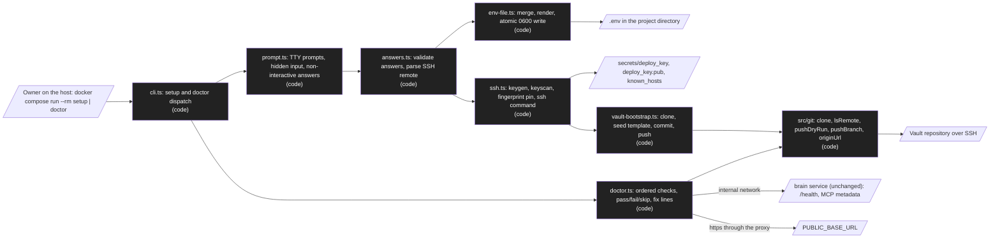

# Design: Installer

Status: approved  |  Date: 2026-11-01  |  Requirements: ./requirements.md
ADRs: docs/adr/0017-installer-runs-in-the-container.md (accepted), docs/adr/0005-vault-in-git.md, docs/adr/0007-mcp-auth.md, docs/adr/0010-ingest-bearer-token.md, docs/adr/0015-public-mcp-app.md

Every item below cites the requirement IDs it serves. Anything without an R reference does not
belong here.

## Overview
The owner clones this repository on a Linux Docker host and runs `docker compose run --rm setup`.
That starts the service image with the project directory bind-mounted, and `node dist/cli.js
setup` asks a few questions, writes `.env` (0600) with a generated ingest token and the
passphrase hash, creates an ed25519 deploy key and a pinned `known_hosts` in `secrets/`, waits
until the owner has added the key to the vault repository, then clones the vault into the `vault`
volume and seeds the template when the vault has no config (R1, R2, R3, R5). The owner starts the
service with `docker compose up -d --build`, adds the proxy snippet from docs/INSTALL.md and runs
`docker compose run --rm doctor`, which checks every link from `.env` to the public origin and
prints a fix for each failure (R4, R6). Nothing calls a model and nothing new is installed on the
host beyond Docker, Compose and git (R7.6, ADR 0017).

## Architecture


| Node / component | Kind | Responsibility | Location | Serves |
|---|---|---|---|---|
| CLI dispatch | code | `setup` and `doctor` added to `main`, usage lines, exit codes 0, 1, 2 | src/cli.ts | R1.11, R4.1, R4.2, R7.5 |
| Prompts | code | Line prompts with defaults; hidden passphrase (raw mode, nothing echoed), asked twice; confirmations; flags and stdin in non-interactive mode | src/install/prompt.ts | R1.1, R1.4, R1.9, R1.11, R2.3, R2.6 |
| Answers | code | Zod schemas with fixed messages; reuses `isAllowedBaseUrl` (exported from src/config/env.ts) and `hashPassphrase` (src/auth/owner.ts); SSH remote parser | src/install/answers.ts | R1.4, R1.9, R1.10, R1.12 |
| Env file | code | Parse with `node:util` `parseEnv`, merge managed keys, keep other lines, render, write `.env.tmp-<random>` with 0600 then rename; token from `randomBytes(32)` | src/install/env-file.ts | R1.2, R1.3, R1.5, R1.7, R1.8 |
| SSH | code | Runs `ssh-keygen` and `ssh-keyscan` (image binaries) through an injected runner; computes the SHA256 fingerprint in Node; GitHub constant; renders `known_hosts`; builds the git SSH command | src/install/ssh.ts | R2.1, R2.2, R2.4 to R2.10 |
| Vault bootstrap | code | Clone, origin check, empty or config-less seed through the `init-vault` copy (exported from src/cli.ts), config validation with `loadVaultConfig`, commit, push | src/install/vault-bootstrap.ts | R3.1 to R3.8, R7.1 |
| Git additions | code | `lsRemote`, `pushDryRun`, `pushBranch`, `originUrl`, `cloneInto`; all through `runGit` (argument arrays, stderr dropped) | src/git/index.ts | R3.7, R4.6, R4.7 |
| Doctor | code | Check registry in the R4.1 order; each check returns pass, fail with a fix, or skip | src/install/doctor.ts | R4.1 to R4.15 |
| Compose wiring | code | `setup` and `doctor` services under profile `tools`, mounts, shared SSH command, `env_file` not required | compose.yaml | R5.1 to R5.8, R7.4 |
| Ignore files | code | `secrets/` in `.gitignore` and `.dockerignore` | .gitignore, .dockerignore | R5.6 |
| Install guide | code | docs/INSTALL.md; README Install section; warning removed; guide test | docs/INSTALL.md, README.md, tests/guide-install.test.ts | R6.1 to R6.6 |

## Workflow vs agent
Workflow, because every step of an install is known in advance and must be the same for every
owner; there is no model in setup or doctor (R7.6). Risks of an agent: a model choosing commands
on a host that holds secrets, non-repeatable installs, and API cost. (ADR 0002, ADR 0017)

## Data model / schema impact
- `.env` in the project directory, mode 0600. Managed keys (R1.2, R1.3, R1.7): `VAULT_REMOTE`,
  `GIT_AUTHOR_NAME`, `GIT_AUTHOR_EMAIL`, `INGEST_TOKEN` (base64url of 32 random bytes),
  `PUBLIC_BASE_URL`, `OWNER_PASSPHRASE_HASH` (single quoted), `TRUST_PROXY_HOPS` (default `1` when
  a base URL is set, else `0`), `N8N_NETWORK` (default `n8n`). Every other line is kept byte for
  byte; a managed key that is missing is appended under a `# Written by 2brain setup` comment.
  Rendering is deterministic, so a re-run with the same answers writes nothing (R1.8).
- `secrets/` in the project directory, mode 0700 (R2.1, R2.8):
  ```text
  secrets/deploy_key       ed25519 private key, no passphrase, comment "2brain deploy key", 0600
  secrets/deploy_key.pub   public key, 0644
  secrets/known_hosts      one line: <host or [host]:port> ssh-ed25519 <base64>, 0600
  ```
- Vault repository: at most one commit `2brain: seed vault template` by the configured author,
  holding only template files the vault does not have; pushed to `main` for an empty remote, to
  the current branch otherwise (R3.2, R3.3). No other vault change (R3.4).
- Retention: setup never deletes `.env`, a key or a vault file; rotating the key means the owner
  deletes `secrets/deploy_key*` and re-runs setup (R2.2).

## Interfaces and contracts
```text
node dist/cli.js setup [--project-dir <dir>] [--vault-dir <dir>]
node dist/cli.js setup --non-interactive --remote <ssh url> --author-name <name>
    --author-email <email> [--public-base-url <origin> --trust-proxy-hops <n>
    (--passphrase-stdin | --keep-passphrase)] [--n8n-network <name>]
    [--host-fingerprint SHA256:<base64>] [--project-dir <dir>] [--vault-dir <dir>]
node dist/cli.js doctor [--project-dir <dir>]
docker compose run --rm setup        # profile tools; same flags after the service name
docker compose run --rm doctor
```
Defaults: `--project-dir /project`, `--vault-dir` from `VAULT_DIR`, else `/data/vault`. Exit
codes: 0 done (setup) or no failed check (doctor); 1 a step or check failed; 2 usage error or
missing non-interactive answers (R1.11, R4.2).

Prompts in order (R1.1, R1.4, R2.3, R2.6): vault remote; author name; author email; public base
URL (empty keeps MCP off); proxy hop count; keep the current passphrase (only when a hash exists);
passphrase and repeat (hidden); Docker network name; host fingerprint `yes` (non-GitHub hosts
only); "Added the deploy key with write access? Press Enter".

Setup result codes (one line each, `setup: <code>: <fix>`): `invalid_answer`, `remote_not_ssh`,
`missing_answers`, `project_not_writable`, `keygen_failed`, `host_unreachable`,
`host_key_mismatch`, `host_key_rejected`, `remote_unreachable`, `remote_auth_failed`,
`vault_remote_mismatch`, `config_invalid`, `push_refused`, `done`.

Doctor checks (R4.1 to R4.14):

| Id | How | Fails when | Fix line |
|---|---|---|---|
| `env` | `loadEnv` on the process environment (Compose loads `.env`) | startup rules break | the variable names, "re-run setup" |
| `env_file` | `stat` of `<project>/.env` | group or other bits set, or missing | `chmod 600 .env` |
| `secrets` | `stat` of the key and `known_hosts` | missing, or group or other bits set | re-run setup, or `chmod 600` |
| `network` | `dns.lookup("brain")` | name does not resolve | `docker network create <N8N_NETWORK>`, `docker compose up -d` |
| `remote_reachable` | `git ls-remote --heads origin`, 15 s | non-zero or timeout | check the deploy key and the host key |
| `remote_pushable` | `git push --dry-run origin HEAD`, 15 s | refused | give the deploy key write access |
| `vault_config` | `loadVaultConfig` on the clone | no clone, or invalid | file and key path, or re-run setup |
| `ingest_health` | `GET http://brain:<PORT>/health`, 5 s | not 200 `{"ok":true}` | `docker compose ps`, `docker compose logs brain` |
| `mcp_internal` | `GET http://brain:<MCP_PORT>/.well-known/oauth-authorization-server`, 5 s | not 200 or issuer differs | check `PUBLIC_BASE_URL` and the logs |
| `proxy_metadata` | same path on `PUBLIC_BASE_URL`, https, no redirects followed, 10 s | TLS error, not 200, issuer differs, redirect | INSTALL.md, Proxy section |
| `proxy_mcp` | `GET <PUBLIC_BASE_URL>/mcp`, no token, 10 s | status other than 401 | forward `/mcp`, `/authorize`, `/token`, `/register`, `/revoke`, `/.well-known/` |

The last three report `skip` while `PUBLIC_BASE_URL` is empty (R4.10). The MCP listener has no
health route (src/mcp/app.ts `PUBLIC_PATHS`), so the metadata document is the probe (D7). Output
format, fixed strings plus ids, codes and paths only (R4.14):
```text
pass  env
fail  remote_pushable
      fix: add secrets/deploy_key.pub to the repository as a deploy key with write access
skip  proxy_mcp (PUBLIC_BASE_URL is empty: claude.ai cannot connect)
doctor: 1 failed, 8 passed, 2 skipped
```

Compose additions (R5.1 to R5.5, R7.4):
```yaml
x-git-ssh: &git-ssh "ssh -i /run/2brain/deploy_key -o IdentitiesOnly=yes -o UserKnownHostsFile=/run/2brain/known_hosts -o StrictHostKeyChecking=yes -o BatchMode=yes"
services:
  brain:       # unchanged except: env_file [{path: .env, required: false}], GIT_SSH_COMMAND: *git-ssh, ./secrets:/run/2brain:ro
  setup:
    build: .
    profiles: [tools]
    command: ["node", "dist/cli.js", "setup"]
    environment: { VAULT_DIR: /data/vault, GIT_SSH_COMMAND: "<same flags, /project/secrets paths>" }
    volumes: [".:/project", "vault:/data/vault"]
  doctor:
    build: .
    profiles: [tools]
    env_file: [{ path: .env, required: false }]
    command: ["node", "dist/cli.js", "doctor"]
    environment: { VAULT_DIR: /data/vault, GIT_SSH_COMMAND: *git-ssh }
    volumes: [".:/project:ro", "./secrets:/run/2brain:ro", "vault:/data/vault:ro"]
    networks: [n8n]
```

n8n credential (R6.3): type Header Auth, name `2brain ingest`, header `Authorization`, value
`Bearer <INGEST_TOKEN>`; ingest URL `http://brain:<PORT>` (default `http://brain:3000`) on the
shared network. F5 to F7 templates reference that credential name. The owner reads the token from
`.env` themselves; setup never prints it (R1.6).

Proxy snippets in INSTALL.md (R6.2), with `TRUST_PROXY_HOPS=1`:
```text
Caddy:  brain.example.com { reverse_proxy brain:3001 }
nginx:  server { listen 443 ssl; server_name brain.example.com; location / { proxy_pass http://brain:3001;
        proxy_set_header Host $host; proxy_set_header X-Forwarded-For $proxy_add_x_forwarded_for;
        proxy_set_header X-Forwarded-Proto https; } }
```

## Error handling
| Failure | Scope (per item / fatal) | Response | Retry (backoff, max) | Serves |
|---|---|---|---|---|
| Invalid answer on a TTY | per answer | name field and rule, ask again | until valid | R1.9 |
| Invalid or missing answer, non-interactive | fatal | exit 1 `invalid_answer` or exit 2 `missing_answers`, nothing written | none | R1.11, R1.12 |
| Remote not SSH or with a credential | per answer | `remote_not_ssh`, value not stored | ask again (TTY) | R1.10 |
| Project directory not writable | fatal | exit 1 `project_not_writable` with the ownership fix | re-run | R1.5 |
| `ssh-keygen` fails | fatal | exit 1 `keygen_failed`, partial key files removed | re-run | R2.1 |
| Host key fetch fails | fatal | exit 1 `host_unreachable` | one try, 10 s | R2.10 |
| Fingerprint mismatch (GitHub) or not confirmed | fatal | exit 1 `host_key_mismatch` or `host_key_rejected`, no `known_hosts` | none | R2.5, R2.7 |
| Clone or ls-remote fails | fatal | exit 1 `remote_unreachable` or `remote_auth_failed` (exit 128 with `Permission denied` detected by code, not text shown) | re-run | R3.7 |
| Origin differs | fatal | exit 1 `vault_remote_mismatch` | none | R3.8 |
| Config invalid | fatal | exit 1 `config_invalid` with file and key path | none | R3.5 |
| Push refused | fatal | exit 1 `push_refused`, commit kept | re-run pushes it | R3.6 |
| A doctor check fails | per check | `fail` plus fix, next check runs | none | R4.1 |

- Idempotency: `.env` keeps values and renders deterministically; an existing key is kept; the
  seed copies only missing files and commits only when something was copied; a clone ahead of
  origin is pushed without a new commit (R1.7, R1.8, R2.2, R3.4, R3.6).
- Concurrency limit: one setup at a time by convention; vault steps run only when there is no
  clone or the clone is ahead, so a running `brain` is not disturbed (R3.4).
- Cleanup: the `.env` temporary file and a half-written key are removed in `finally` (R1.5, R2.1).
- Git stderr is never printed: `GitError` carries only the subcommand and exit code (R3.7, R4.14).

## Security considerations
- Secrets files: `.env` and `secrets/` private files 0600, directory 0700, written atomically;
  doctor fails on wider modes (R1.5, R2.1, R2.8, R4.4).
- No echo and no print: the passphrase is read in raw mode, hashed with `hashPassphrase`, and
  dropped; `INGEST_TOKEN`, the hash and the passphrase never appear in output or errors; answers
  are echoed only for non-secret fields (R1.4, R1.6, R4.14).
- Key scope: one deploy key per vault repository, write access to that repository only; no
  personal token, no token in a URL (R1.10, R2.3).
- Host key pinning: GitHub's published ed25519 fingerprint is a constant in src/install/ssh.ts
  with its source URL (https://docs.github.com/en/authentication/keeping-your-account-and-data-secure/githubs-ssh-key-fingerprints);
  other hosts need an explicit `yes` or `--host-fingerprint`; every SSH call uses
  `StrictHostKeyChecking=yes`, `IdentitiesOnly=yes` and `BatchMode=yes` (R2.4 to R2.9).
- Bind-mount scope: `setup` mounts only the project directory and the vault volume, `doctor`
  mounts them read-only; the Docker socket is never mounted; no port is published (R5.2, R5.3,
  R7.4).
- Input validation: every answer through Zod with fixed messages, as in src/config/env.ts (R1.9).
- External calls: only the Git host, the public origin and `brain` (R7.6).
- New dependencies and their risk: none; `node:crypto`, `node:util`, `node:dns`, `fetch`, and the
  `git`, `ssh-keygen` and `ssh-keyscan` binaries already in the image (openssh-client).
- Security gate required: yes, because the feature writes secrets and keys and sets SSH trust.

## Testing strategy
| Level | What | Covers |
|---|---|---|
| unit | prompt order and defaults with a scripted io; hidden input never echoed; answer schemas and messages; SSH remote parser (scp form, `ssh://` with port, https and credential refused); env merge, render, token length, quoting, kept lines; non-interactive flags and exit 2; fingerprint computation from a fixture key; GitHub match and mismatch; non-GitHub confirm and reject; known_hosts line with port; SSH command flags; keyscan timeout via injected runner; git exit-code mapping; doctor order, statuses, exit code, skip rule, fix lines, mode checks, DNS failure via injected resolver; output scanned for planted secret values; compose shape (profiles, mounts, `GIT_SSH_COMMAND`, network, no ports); ignore files; guide and README text; no `@anthropic-ai/sdk` or `src/llm` import in src/install | R1.1 to R1.4, R1.6, R1.7, R1.9 to R1.12, R2.2 to R2.10, R3.7, R4.1 to R4.5, R4.10, R4.14, R5.1 to R5.6, R6.1 to R6.6, R7.2, R7.4 to R7.6 |
| integration | real files in a temp project dir (modes, atomic rename, byte-identical re-run); real `ssh-keygen` on Linux CI; bootstrap and doctor git checks against a local bare repository addressed by its path (tests/helpers/git-fixture.ts), not `file://` and not a local sshd, with SSH steps covered by the injected runner; refused push via a bare repo `pre-receive` hook that exits 1; doctor HTTP checks against local servers (the real public app for pass; wrong issuer, 302 to http, 500 for fail) with an injected fetch for TLS errors; read-only clone checked unchanged after doctor | R1.5, R1.8, R2.1, R3.1 to R3.6, R3.8, R4.6 to R4.9, R4.11 to R4.13, R4.15, R7.1, R7.3 |
| manual | `docker compose run --rm setup` with no `.env`; doctor without the network; fresh-host install to a saved note from claude.ai; doctor on the reference install | R5.7, R5.8, R6.7, R6.8 |

No `[eval]` or `[e2e]` criteria: there is no LLM output and no web UI in this feature.

## Risk and cost
Parts that will be tier C at build time (DESIGN.md section 6.1). Approving this design approves
the decisions; each plan is still escalated so the user can check it matches.

| Item | Why tier C | Cost estimate (monthly) | Serves |
|---|---|---|---|
| compose.yaml: `setup`, `doctor`, secrets mount, `GIT_SSH_COMMAND`, optional `env_file` | Sensitive path (`compose*.yaml`), deploy | none | R5 |
| Dockerfile: no change expected (openssh-client already ships `ssh-keygen` and `ssh-keyscan`); any change escalates | Sensitive path | none | R2.1 |
| `.env.example`: new comments for `TRUST_PROXY_HOPS` default and the setup command | Secrets | none | R1.2 |
| `src/install/**` writes secrets and SSH trust | Secrets, auth; recommend adding `src/install/**` to AGENTS.md Sensitive paths (AGENTS.md change) | none | R1, R2 |
| `.gitignore` and `.dockerignore`: `secrets/` | Harness-touched file, secrets | none | R5.6 |

Paid services this feature needs: none. No LLM call in setup or doctor; cost USD 0. The VPS and
the domain are the owner's.

## Alternatives considered
| Option | Why rejected |
|---|---|
| Bash script on the host | Needs Node or many host tools, not testable in the Vitest suite, shell-string risks (ADR 0017) |
| `npx` package | Needs Node 24 on the host and a published package; the image already has Node, git and ssh (ADR 0017) |
| HTTPS token in `VAULT_REMOTE` | A long-lived credential in `.env`, echoed by git in messages and broad in scope; a deploy key is per repository |
| Bundled Caddy | Competes with n8n's proxy for ports 80 and 443 on the reference host; TLS and DNS are out of scope |
| `StrictHostKeyChecking=accept-new` or `no` | Trust on first use without checking; forbidden by README.md |
| Docker socket in doctor to inspect networks | Root-equivalent access to the host for one check; DNS of `brain` answers the same question |

## Decision log
- 2026-11-01: file ownership in the bind mount: setup runs as root when the container user is root, gives `.env` to the owner of the project directory and `secrets/` to uid 1000 (the image user), and runs git and ssh as uid 1000 (task T13).
- 2026-11-01: `src/install/**` is not added to AGENTS.md Sensitive paths. Tasks that write `.env`, keys or SSH trust still get a security review by trigger, and every compose or env-file change stays tier C; making all installer code tier C would gate routine fixes on the human.
- 2026-11-01 D1: the installer is `setup` in src/cli.ts, run in the service image through the
  `tools` profile with the project directory bind-mounted; idempotent; TTY prompts and a
  non-interactive mode for CI tests (ADR 0017) (R1, R5).
- 2026-11-01 D2: `.env` 0600, never printed, with a generated `INGEST_TOKEN`, the passphrase hash
  from `hashPassphrase`, `PUBLIC_BASE_URL` validated as in env.ts, author, remote, network; plus
  `TRUST_PROXY_HOPS` because the proxy step needs it (docs/GUIDE-mcp.md, step 3) (R1).
- 2026-11-01 D3: ed25519 deploy key in `secrets/`, read-only mount, `IdentitiesOnly`, pinned
  `known_hosts`, GitHub fingerprint check or owner confirmation, never `StrictHostKeyChecking=no`;
  no token in URL (R2).
- 2026-11-01 D4: clone; seed the template through the `init-vault` copy when the vault has no
  config; validate and keep an existing config. The seed commit is template files only, not notes,
  so it goes through src/git like `init-vault` output, not through the src/vault note writer (R3).
- 2026-11-01 D5: `doctor` with the eleven checks above, non-zero exit on any failure, no secrets
  in output (R4).
- 2026-11-01 D6: no bundled proxy; Caddy and nginx snippets in docs/INSTALL.md (R6.2).
- 2026-11-01 D7: the MCP listener has no health route, so doctor probes the authorization server
  metadata, internally and through the proxy (R4).
- 2026-11-01 D8: docs/INSTALL.md is the one linear guide; README gets an Install section and loses
  the throwaway-vault warning; n8n credential name `2brain ingest` (R6).
- 2026-11-01 D9: out of scope as listed in requirements.md; the owner adds the docs/v2.md rows.
- 2026-11-01 D10: cost none; no LLM call (R7.6).

## Open questions
- BLOCKING: none.
- ADVISORY: file ownership in the bind mount (default: the `setup` service runs as root only to
  create files, then gives `.env` to the owner of the project directory and `secrets/` to uid 1000
  (`node`, which `brain` runs as, so ssh can read the key), and drops to uid 1000 with
  `process.setgid` and `process.setuid` before any git call; alternative: run as `node` and ask
  owners whose host user is not uid 1000 to `chown` the project directory).
- ADVISORY: `env_file` with `required: false` needs Compose 2.24.0 or later (default: state that
  minimum in INSTALL.md prerequisites; without it, `docker compose run setup` may refuse to start
  while `.env` is missing).
- ADVISORY: does `git push --dry-run` reach the receive-pack check that refuses a read-only deploy
  key, and does it work on a read-only clone (default: yes for GitHub; verify at build; if not,
  doctor mounts the clone read-write and still pushes nothing).
- ADVISORY: does `GET /mcp` without a token answer 401 (default: yes, docs/GUIDE-mcp.md
  troubleshooting; verify against src/mcp/server.ts at build).
- ADVISORY: hairpin access from the container to `PUBLIC_BASE_URL` (default: the check runs from
  the doctor container; on hosts without hairpin NAT the fix line says to run the same request from
  another machine).
- ADVISORY: branch for an empty remote (default: `main`).
- ADVISORY: add `src/install/**` to AGENTS.md Sensitive paths (default: yes).
