# Design: Meetings without LLM

Status: approved  |  Date: 2026-11-01  |  Requirements: ./requirements.md
ADRs: docs/adr/0018-meeting-versions-as-linked-notes.md, docs/adr/0019-meeting-ingest-contract.md, docs/adr/0020-meetings-config-section.md

Every item below cites the requirement IDs it serves. Anything without an R reference does not
belong here.

## Overview
n8n learns of a finished transcript (a schedule that polls the Fireflies API by default, or a
Fireflies webhook where the owner's plan offers it, and a schedule that polls the Google Meet
API), fetches the transcript and the calendar events around it with the owner's credentials, and
posts the source's own API shapes to `POST /meetings` on the internal ingest app (R1, R11). The
service maps each source to one internal `MeetingInput` (R2.6 to R2.8), normalizes the segments
into a deterministic body (R2.1 to R2.5), and, inside the existing serialized write queue, pulls,
loads the config (R10), skips short or empty recordings (R3), answers `already_stored` for a known
source id (R8.1, R8.2), picks the calendar event and the area (R4, R5), builds the frontmatter
(R6), finds the other source's version of the same meeting (R7), and writes the new note plus the
versions link on the other note in one commit through `src/vault/` (R6.5, R7.3). No step calls a
model or an outside API (R9).

## Architecture

```mermaid
flowchart LR
  FFP[/"Schedule: Fireflies poll (default)"/] --> NF["n8n template meetings-fireflies<br/>(code)"]
  FF[/"Fireflies webhook: Transcription completed (optional)"/] --> NF
  NF <--> ST["Poll state: posted, pending, daily count<br/>(code)"]
  MEET[/"Schedule: Google Meet API conference records"/] --> NG["n8n template meetings-gemini<br/>(code)"]
  NF --> ROUTE
  NG --> ROUTE
  ROUTE["POST /meetings: token, 4 MiB, schema<br/>(code)"] --> MAP["Source mappers: Fireflies, Gemini<br/>(code)"]
  MAP --> NORM["Normalize segments to body<br/>(code)"]
  NORM --> Q["Serialized write queue: pull, config<br/>(code)"]
  Q --> SKIP["Skip rules, already stored<br/>(code)"]
  SKIP --> CAL["Pick calendar event, name, area<br/>(code)"]
  CAL --> FM["Meeting frontmatter, person links<br/>(code)"]
  FM --> VER["Find other version<br/>(code)"]
  VER --> W["Vault write path: validate, scrub, create, link, one commit, push<br/>(code)"]
  W --> OUT[/"Vault repository"/]
  classDef code fill:#222,color:#fff
  class NF,ST,NG,ROUTE,MAP,NORM,Q,SKIP,CAL,FM,VER,W code
```

Every node is `code`; there is no `llm` or `ai-model` node (R9).

| Node / component | Kind | Responsibility | Location | Serves |
|---|---|---|---|---|
| n8n Fireflies template | code | Schedule trigger (enabled, 60 min) with GraphQL `transcripts(fromDate, limit: 50)`, or webhook trigger (disabled at import) on a random path filtering the event; GraphQL `transcript(id)`, calendar query, post, retries; a `Settings` node holds `daily_budget` | n8n/templates/meetings-fireflies.json | R11.1 to R11.3, R11.5 to R11.10, R11.17 |
| Fireflies poll state | code | One Code node over workflow static data: picks the ids to fetch, reserves budget before each request, records 200 and 201 answers, keeps pending ids, stops on rate limit; runs again as the last node on every path | n8n/templates/meetings-fireflies.json (Code node `Poll state`) | R11.11 to R11.16 |
| n8n Gemini template | code | Schedule, Meet API `conferenceRecords` ended in 24 h, transcripts, paginated entries, participants, calendar query, post, retries | n8n/templates/meetings-gemini.json | R11.1, R11.2, R11.4 to R11.7, R11.18 |
| Meeting route | code | `POST /meetings` behind the existing token middleware, 4 MiB limit, JSON checks, Zod parse, error mapping | src/server/app.ts | R1.1 to R1.5 |
| Payload schemas | code | Zod per source (only the fields used, unknown fields ignored), limits, finished state, https URL filter | src/meetings/schema.ts | R1.3, R1.6, R1.7 |
| Fireflies mapper | code | Fireflies transcript to `MeetingInput` | src/sources/fireflies/map.ts | R2.6 |
| Gemini mapper | code | Conference record, transcript, entries and participants to `MeetingInput` | src/sources/gemini/map.ts | R2.7, R2.8 |
| Normalizer | code | NFC, whitespace, ordering, speaker turns, offsets, unknown speaker | src/meetings/normalize.ts | R2.1 to R2.5, R3.2 |
| Calendar picker | code | Overlap, exclusions, tie breaks | src/meetings/calendar.ts | R4.1, R4.2 |
| Namer | code | Local date and time in the configured zone, title cleaning, length cut, untitled name, collision suffix | src/meetings/name.ts | R4.3 to R4.6 |
| Area router | code | Ordered rules by calendar id or email domain, default area, folder | src/meetings/area.ts | R5.1 to R5.3 |
| Meeting frontmatter | code | Canonical and meeting properties under owner names, participants deduplicated | src/meetings/frontmatter.ts | R6.1, R6.2, R6.4 |
| Version matcher | code | Pure match over candidate notes: other source, event id or 50% overlap, tie breaks | src/meetings/versions.ts | R7.1, R7.4, R7.5 |
| Meeting writer | code | One queue slot: sync, config, skip, source lookup, person and version scan, path choice, create plus link, one commit, push | src/vault/write-meeting.ts | R3.1, R3.3, R4.6, R6.3, R6.5, R7.2, R7.3, R7.6, R8 |
| Meetings config | code | Optional strict `meetings` section, defaults, cross checks | src/config/vault-config.ts, src/config/defaults.ts, vault-template/.2brain/config.yaml | R10 |
| Guide | code | Setup steps for both sources, Fireflies mode choice, interval and budget, Workspace edition and Meet API check | docs/GUIDE-meetings.md, link in docs/INSTALL.md | R12 |

## Workflow vs agent
Workflow, because the path of a transcript is fixed and known in advance: map, normalize, name,
place, link, write (docs/adr/0002-workflow-vs-agent.md, docs/adr/0004-meetings-without-llm.md).
An agent would add model cost and untestable naming choices to the largest input of the system.
(R2 to R9)

## Data model / schema impact
- `.2brain/config.yaml` gains an optional `meetings` section (ADR 0020). Version stays 1: a vault
  without the section keeps validating and gets the defaults (R10.1). Code defaults
  (src/config/defaults.ts) and the template stay equal by the existing test (R10.1):

```yaml
meetings:
  timezone: UTC                    # IANA name; date, HH-MM and offsets use it (R4.1, R4.3, R6.2)
  min_minutes: 5                   # recordings of this length or less are skipped (R3.1)
  untitled_label: Untitled meeting # R4.3
  unknown_speaker_label: Speaker   # R2.3, R2.8
  default_area: null               # null means the first configured area (R5.2)
  area_rules: []                   # e.g. [{ domain: example.com, area: work }, { calendar: team@example.com, area: work }] (R5.1)
  sources:                         # value stored in `source`, label used in the version suffix (R6.1, R7.2)
    fireflies: { value: fireflies, label: Fireflies }
    gemini: { value: gemini, label: Gemini }
  properties:                      # canonical meeting property -> owner property name (R6.2, R7.3)
    start: start
    end: end
    duration: duration_minutes
    participants: participants
    calendar_event: calendar_event
    source_title: source_title
    source_url: source_url
    versions: versions
```

  Cross checks (R10.2, R10.3): rule areas and `default_area` must be configured areas; each area
  rule has exactly one of `domain` or `calendar`; `timezone` must be accepted by
  `Intl.DateTimeFormat`; `min_minutes` is an integer from 0 to 120; meeting property names are
  distinct and differ from the five canonical owner names and from `analysis` (the skill's
  property, F3 R9.4). The checks about `types.meeting` and the `sources` allow-list run only for
  meeting requests, so a vault without meetings keeps every other write working (R10.3).
- Meeting note (owner names from config; default names shown) (R6.1, R6.2, R7.3):

```yaml
---
type: meeting
area: work
date: 2026-10-30
source: fireflies
source_id: fireflies:01EXAMPLEID
start: 2026-10-30T14:02:10-05:00
end: 2026-10-30T14:48:55-05:00
duration_minutes: 46
participants: ["[[Ana Ruiz]]", "Bo Chen", "dev@example.com"]
calendar_event: evt_example_1
source_title: Weekly sync
source_url: https://app.fireflies.ai/view/01EXAMPLEID
versions: ["[[2026-10-30 · Weekly sync (Gemini)]]"]
---
**Ana Ruiz** [00:00:04]
Let us start with the numbers.

**Speaker 2** [00:00:31]
Sure. The pilot closed at 120 users.
```

  `versions` is written on create when a version exists and set on the other note by a
  frontmatter-only update; it is the only property `POST /meetings` ever changes on a stored note
  (R7.3, R8.3). An absent property (no event, no https URL) is omitted, not written as null
  (R1.7, R6.2).
- Retention and deletion: nothing is deleted; source recordings stay in Fireflies and Google
  (R8.3; deletion deferred, docs/v2.md).
- n8n poll state (Fireflies template only, in n8n's workflow static data, never in the vault or
  the service) (R11.11 to R11.16). It holds ids and timestamps only, no titles, names or text:

```json
{
  "day": "2026-11-01",
  "used": 27,
  "posted": { "01EXAMPLEID": "2026-11-01T15:04:00Z" },
  "pending": { "01EXAMPLEID2": "2026-10-31T21:10:00Z" }
}
```

  `used` resets when `day` (UTC) changes (R11.13). `posted` entries older than 48 hours are
  dropped (R11.11). `pending` entries stay until a 200 or 201 answer or a 4xx drop (R11.15,
  R11.16). Static data persists only for active workflows, so the guide tells the owner to
  activate the workflow rather than run it by hand (R12.1).

## Interfaces and contracts
```ts
// POST /meetings (ingest app, Authorization: Bearer <INGEST_TOKEN>, application/json, <= 4 MiB)
type CalendarEvent = {
  id: string; calendar_id?: string; title?: string;
  start: { dateTime?: string; date?: string };      // Google Calendar shape; `date` means all-day
  end: { dateTime?: string; date?: string };
  status?: string;                                   // "cancelled" is ignored (R4.2)
  organizer?: { email?: string };
  attendees?: { email?: string; displayName?: string; self?: boolean; responseStatus?: string }[];
};
type FirefliesBody = {
  source: "fireflies";
  transcript: {                                      // Fireflies GraphQL `transcript` fields used
    id: string; title?: string; date: number;        // date: start in epoch ms
    duration: number;                                // minutes (float)
    transcript_url?: string; organizer_email?: string;
    participants?: string[];                         // emails
    meeting_attendees?: { displayName?: string; email?: string; name?: string }[];
    sentences: { speaker_name?: string | null; text: string; start_time: number }[]; // seconds
  };
  calendar_events: CalendarEvent[];
};
type GeminiBody = {
  source: "gemini";
  conference: { name: string; startTime: string; endTime: string };
  transcript: { name: string; state: string; docsDestination?: { exportUri?: string } };
  participants: { name: string; signedinUser?: { displayName?: string };
                  anonymousUser?: { displayName?: string }; phoneUser?: { displayName?: string } }[];
  entries: { participant: string; text: string; startTime: string }[];
  calendar_events: CalendarEvent[];
};
// Internal, after mapping (R2):
type MeetingInput = {
  source: "fireflies" | "gemini"; sourceId: string;  // stored as `<source value>:<sourceId>`
  start: Date; end: Date; sourceTitle?: string; sourceUrl?: string;
  people: { name?: string; email?: string }[]; organizerEmail?: string;
  segments: { speaker: string; offsetSeconds: number; text: string }[];
  calendarEvents: CalendarEvent[];
};
type MeetingOk =
  | { ok: true; path: string; commit: string; linked?: string; redactions?: Redaction[] } // 201
  | { ok: true; path: string; commit: null; already_stored: true }                          // 200
  | { ok: true; commit: null; skipped: "too_short" | "empty_transcript" };                  // 200
```

| Endpoint / function | Input | Output | Errors | Serves |
|---|---|---|---|---|
| `POST /meetings` | FirefliesBody or GeminiBody | 201 stored; 200 already_stored or skipped | 400 invalid_body, invalid_json, invalid_frontmatter, wrong_folder, unsafe_path; 401; 409 transcript_not_ready, note_exists; 413; 415; 502 push_pending; 503 config_invalid; 500 scrub_failed, write_failed | R1, R3, R8 |
| `parseMeetingBody(json)` | unknown | FirefliesBody or GeminiBody | ZodError (paths and messages only) | R1.3, R1.6, R1.7 |
| `mapFireflies(body)` / `mapGemini(body, labels)` | parsed body | MeetingInput | none | R2.6 to R2.8 |
| `normalizeSegments(segments, unknownLabel)` | segments | `{ body: string; turns: number }` | none | R2.1 to R2.5, R3.2 |
| `pickEvent(events, start, end)` | events, range | CalendarEvent or undefined | none | R4.1, R4.2 |
| `meetingTitle(event, start, cfg, maxLen)` | event, start, config | cleaned title | none | R4.3 to R4.5 |
| `routeArea(event, input, cfg)` | event, input, config | area | none | R5.1, R5.2 |
| `matchVersion(input, eventId, candidates)` | input, candidates `{path, source, start, end, calendarEvent}` | path or undefined | none | R7.1, R7.4, R7.5 |
| `writer.writeMeeting(input)` | MeetingInput | MeetingOk | vault errors of src/server/errors.ts | R3, R4.6, R6.3, R6.5, R7.2, R7.3, R7.6, R8 |

Fireflies poll (n8n only; the service contract above does not change with the trigger) (R11.9 to
R11.16):

| Step | Fireflies requests | Serves |
|---|---|---|
| `Poll state` reserves 1 request; if `used + 1 > daily_budget`, the poll ends with no request | 0 or 1 reserved | R11.13 |
| GraphQL `transcripts(fromDate: now - 24 h, limit: 50)` returns ids and dates only | 1 | R11.10 |
| `Poll state` computes `(listed + pending) - posted` and reserves 1 request per id while the budget allows; the rest join `pending` | 0 | R11.11, R11.13, R11.15 |
| Per id: `transcript(id)` (up to 3 tries, each counted), calendar query, `POST /meetings` | 1 to 3 per id | R11.5 to R11.7, R11.13 |
| `Poll state` (last node on every path): 200 or 201 into `posted`; 502, 503, fetch errors and unreached ids into `pending`; 4xx dropped, then `Stop and Error` | 0 | R11.12, R11.15, R11.16 |

Budget at the defaults (R11.13, R11.17): 24 polls a day use 24 list requests, leaving 16 fetches
under the budget of 40; a day of up to 8 meetings uses about 32 requests, against the
plan's limit of about 50. In webhook mode a meeting costs 1 fetch (plus retries). The guide tells
the owner to lengthen the interval when the usual volume is higher (R12.2).

Commit message: `2brain: add meeting <path>`; with a link, the same commit also names the other
path: `2brain: add meeting <path> (version of <other path>)`. Both files go in one
`commitPaths` call (R7.3).

The error table in src/server/errors.ts gains `transcript_not_ready` (409); the meeting route maps
`DuplicateSourceError` to the 200 `already_stored` answer instead of 409 (R8.1). The MCP tools
keep their mapping unchanged.

## Error handling
| Failure | Scope (per item / fatal) | Response | Retry (backoff, max) | Serves |
|---|---|---|---|---|
| Missing or wrong token | per request | 401, no git | none | R1.2 |
| Bad shape, limits, not JSON, too large | per request | 400 / 415 / 413, no git | none (n8n stops) | R1.3 to R1.5 |
| Gemini transcript not finished | per request | 409 `transcript_not_ready` | next scheduled poll (within 24 h window) | R1.6, R11.4 |
| Too short or empty | per request | 200 `skipped`, one log line (source, reason) | none | R3 |
| Source id already stored | per request | 200 `already_stored`; pushes a pending commit first | none | R8.1, R8.2 |
| Path taken by another meeting twice | per request | 409 `note_exists` | none | R4.6 |
| Invalid config or missing meeting type | per request | 503 `config_invalid` with key path | n8n: 3 tries, 60 s apart; owner fixes config | R8.5, R10.2, R10.3 |
| Push fails | per request | 502 `push_pending` with commit | service: 3 retries 1, 2, 4 s (existing); n8n: 3 tries, 60 s apart | R8.4, R11.7 |
| Fireflies or calendar API fails in n8n | per execution | execution stops before the post; in poll mode the id stays pending | n8n: 3 tries, 5 s apart, then stop; next poll | R11.6, R11.15 |
| Fireflies rate-limit error (429 or `too_many_requests`) | per execution | no further Fireflies request in that execution; unposted ids stay pending | none in the execution; next poll | R11.14, R11.15 |
| Daily request budget reached | per poll | no Fireflies request; listed ids stay pending | next UTC day | R11.13, R11.15 |
| Ingest answers 4xx to a polled transcript | per id | id dropped from pending, execution marked failed | none (owner reads the execution) | R11.16 |
| Scrub exception | per request | 500 `scrub_failed`, nothing written | none | R6.5 |
| Commit fails after the files were written | per request | new file removed, other note's frontmatter restored to its HEAD bytes, 500 `write_failed` | none | R8.3 |

- Idempotency: the source id is the key (R8.1). Normalization is a pure function of the payload,
  so a retry builds the same bytes (R2.5). Polling the last 24 hours re-posts finished meetings;
  each answers `already_stored` with no commit (R11.4, R8.1). The Fireflies poll fetches only
  ids it has not posted; when its state is lost (workflow re-imported), repeats answer
  `already_stored` and are recorded as posted (R11.11, R11.12).
- Concurrency limit: one vault operation at a time (existing queue). Two versions arriving at the
  same moment are ordered by the queue; the second one sees the first (R7.2).
- Cleanup: a failed commit leaves neither the new file nor a changed versions property (R8.3).
  No temporary files hold transcript text; the body exists only in memory and in the note.
- Scan cost: persons are read from the person folder listing only (base names, no content);
  version candidates are the frontmatter blocks of meeting folders, filtered by date within one
  day (R6.3, R7.6). The existing source index limits (20,000 files) apply.

## Security considerations
- Authn: the existing ingest token middleware covers the new route; the ingest app stays on the
  internal Docker network (ADR 0007, ADR 0010) (R1.2).
- Input validation: Zod at the boundary with size and count limits (R1.3, R1.4); titles become
  path segments only after cleaning and the existing path rules (R4.4, R4.5); a source URL is kept
  only when it parses as https and is never fetched (R1.7). The service makes no outbound
  request, so there is no SSRF surface (R9, ADR 0019).
- Prompt injection: no model reads the payload in the service (R9). The analysis skill already
  treats note text as data (F3 R9).
- Secrets: no new environment variable in the service. n8n holds the Fireflies API key, the
  Google credentials and the `2brain ingest` credential; templates carry credential names only
  (R11.2). Scrub runs on body and every frontmatter string, nested lists included (R8.6).
- Personal data: transcripts, participant names and emails, in the owner's private vault
  repository (brief, Security and data). Logs carry source, skip reason, rule counts and paths of
  the error table only, never titles, names or text (R3.3, R8.6).
- Public webhook (webhook mode only; poll mode, the default, opens no public endpoint): the
  Fireflies webhook is reachable through n8n's public URL. It carries only an
  id; n8n fetches that id with the owner's own key, so a forged id yields nothing or a transcript
  the owner already owns. The path is a random value set at import; a forged flood can only use
  Fireflies API quota (R11.3, R11.9; signature check is ADVISORY below).
- New dependencies: none (Intl time zones are built into Node.js 24).
- Security gate required: yes (new external input to files and git, a public webhook in n8n,
  personal data).

## Testing strategy
| Level | What | Covers |
|---|---|---|
| unit | route with a fake writer (token, limits, media type, schema issues without values, not ready, https filter); normalizer table tests and a determinism test; calendar picker; namer (cleaning, length cut, untitled, scrub match); area router; frontmatter builder; version matcher; config schema and cross checks; skip logic with a fake writer; import-graph test over src/meetings, src/sources and src/vault/write-meeting.ts; template JSON checks (parse, URL, credential names only, no secrets or non-example emails, event filter, schedule enabled and webhook disabled, interval and budget settings, one list node, pagination, calendar window, retry and stop settings); the `Poll state` Code node's `jsCode` extracted from the template JSON and run with fake static data and answers (new versus posted ids, 48 h expiry, `already_stored`, budget reserve and UTC day reset, retries counted, rate limit stop, pending kept past the window, 4xx drop); guide content and owner-data scan | R1.2 to R1.7, R2.1 to R2.5, R2.8, R3, R4.1 to R4.5, R5, R6.1, R6.2, R6.4, R7.1, R7.4 to R7.6, R9.1, R10.1 to R10.3, R11.1 to R11.7, R11.9 to R11.16, R12 |
| integration | real bare remote (tests/helpers/git-fixture.ts): store from recorded fictional Fireflies and Meet fixtures (tests/fixtures/meetings/), byte-exact expected notes; person link against a person note; second version name and one-commit link with bodies byte-identical; collision suffix and 409; redelivery `already_stored`; pending push delivered on `already_stored`; push failure 502; invalid config 503; config change applied after pull; scrub in transcript and participants; throwing LLM provider records zero calls | R1.1, R2.6, R2.7, R4.6, R6.3, R6.5, R7.2, R7.3, R8, R9.2, R10.4 |
| e2e | none: no UI | none |
| evals | none: no model output | none |
| manual | import both templates in n8n 2.39.8 and run one real meeting per source, Fireflies in webhook mode if the current plan offers it, else poll; one day of usual meetings within the budget and with no rate-limit error; owner confirms the Workspace edition, enables the Meet API and checks the Cloud project has no billing; one real meeting recorded by both; `analizar-reunion` on it | R11.8, R11.17, R11.18, R13.1, R13.2 |

## Risk and cost
Parts that will be tier C at build time (DESIGN.md section 6.1). Approving this design approves
the decisions; each plan is still escalated so the user can check it matches.

| Item | Why tier C | Cost estimate (monthly) | Serves |
|---|---|---|---|
| n8n/templates/meetings-fireflies.json, meetings-gemini.json | Sensitive path in AGENTS.md (`n8n/templates/**`); the `Poll state` Code node is a narrow exception to ADR 0003 (D18) | none | R11 |
| `meetings` section in the vault config schema and defaults | Data and schema change (the owner's vault file format; ADR 0020) | none | R10 |
| New ingest route `POST /meetings` with a 4 MiB limit and a new error code | Architecture of the ingest API (ADR 0019); otherwise normal code | none | R1, R8 |
| Fireflies API access from n8n | Third-party API on the owner's account, limited to about 50 requests a day on the owner's plan | USD 0 on the owner's current plan (owner decision D13); no paid Fireflies feature is used. Poll mode by default within a budget of 40 requests a day; webhook mode only if the plan offers it, confirmed at the manual check | R11.3, R11.8 to R11.17, R13 |
| Google Meet REST API from n8n | Needs the API enabled in a Google Cloud project and a Workspace edition that produces Gemini transcripts | USD 0 (no per-call price; the Workspace plan is already paid by the owner); the owner confirms the edition and enables the API at the manual check (D16) | R11.4, R11.18, R13 |

Other build-time items are tier B (src/meetings/**, src/sources/fireflies/map.ts,
src/sources/gemini/map.ts, src/vault/write-meeting.ts, src/server/app.ts) and tier A (tests,
docs/GUIDE-meetings.md, vault-template/**). No file matches `src/sources/**/delete*.ts`.

Paid services this feature needs: none. No Anthropic spend (R9), no paid eval (no `[eval]`
criteria), Fireflies at USD 0 on the current plan, Google Meet API at USD 0 (D13, D16, D17).
`Paid services` in AGENTS.md stays unchanged.

## Alternatives considered
| Option | Why rejected |
|---|---|
| One merged note holding both transcripts | The second version would rewrite a stored body (AGENTS.md, ADR 0011) (ADR 0018) |
| Always suffix every note with its source | Contradicts ADR 0004 naming; one-source meetings get noisier names (ADR 0018) |
| Rename the first version when the second arrives | Moves a stored file, breaks links the owner made, and needs a new rename operation (ADR 0018) |
| Service calls Google Calendar and Fireflies itself | Moves credentials out of n8n and adds OAuth flows (ADR 0003, ADR 0019) |
| n8n Code nodes map the payloads | Untested logic outside the harness (ADR 0003, ADR 0019) |
| Require Fireflies webhooks | May need a paid Fireflies plan; the owner's plan must cost USD 0 (D13) (R11.9) |
| Fireflies poll without state, re-fetching the whole window each time | Burns the daily limit on transcripts already stored (R11.11, R11.13) |
| Poll state kept in the service | Adds a stateful route and storage outside the vault for an n8n-only concern; the Code node is tested from the template JSON instead (D18) (R11.11 to R11.16) |
| Gemini from the Google Doc export | No structured times or speakers; parsing a document format that can change |
| LLM speaker naming or summary | Rejected in ADR 0004 |
| Return 409 `duplicate_source` to n8n on redelivery | n8n would treat a safe retry as a failure (R8.1) |

## Open questions
- BLOCKING: none.
- RESOLVED D1: two versions are two linked notes (ADR 0018).
- RESOLVED D2: first version keeps the plain name, a later one gets ` (<label>)` (ADR 0018).
- RESOLVED D3: n8n supplies calendar events; the service calls no outside API (ADR 0019).
- RESOLVED D4: the service maps the sources' own API shapes (ADR 0019).
- RESOLVED D5: Gemini through the Google Meet REST API entries, not the Doc export.
- RESOLVED D6: no calendar match gives `Untitled meeting HH-MM` (ADR 0004); source title kept.
- RESOLVED D7: redelivery answers 200 `already_stored` on the meeting route.
- RESOLVED D8: settings in an optional `meetings` config section (ADR 0020).
- RESOLVED D9: participants link only to existing person notes, by base name.
- RESOLVED D10: Fireflies rename and delete deferred (docs/v2.md).
- RESOLVED D11: no Fireflies signature check in webhook mode; random webhook path, id-only payload.
- RESOLVED D12: 4 MiB limit on `/meetings`, `/notes` keeps 1 MiB.
- RESOLVED D13 (owner, cost): Fireflies on the current plan at USD 0; poll by default, webhook only
  if the plan offers it, confirmed at the manual check (R11.8, R11.9, R11.17).
- RESOLVED D14 (owner, cost): one list per poll plus one fetch per new transcript, 60 min interval,
  daily budget 40 (R11.10, R11.11, R11.13).
- RESOLVED D15 (owner, cost): rate-limit error ends the poll, ids stay pending, next poll retries
  (R11.14, R11.15).
- RESOLVED D16 (owner, cost): Google Meet REST API at USD 0; owner confirms the Workspace edition
  and enables the API at the manual check (R11.18).
- RESOLVED D17 (owner, cost): no Anthropic spend, no paid eval; AGENTS.md `Paid services` unchanged
  (R9).
- RESOLVED D18: poll bookkeeping in one tested n8n Code node over static data (R11.11 to R11.16).
- ADVISORY: verify the Fireflies `x-hub-signature` in n8n if webhook mode is enabled and forged
  webhook calls are seen (default: not built) (R11.3).
- ADVISORY: mention the `versions` property in the `analizar-reunion` skill so it finds both
  versions without a search (default: unchanged; F3 R9.2 already merges by search) (R7.3, R13.2).
