# Design: Capture from Telegram and email

Status: draft  |  Date: 2026-11-01  |  Requirements: ./requirements.md
ADRs: docs/adr/0021-capture-llm-and-spend-guard.md, docs/adr/0022-speech-to-text-in-n8n.md, docs/adr/0023-email-capture-rule.md

Every item below cites the requirement IDs it serves. Anything without an R reference does not
belong here.

## Overview
The Telegram template receives every update of the owner's bot, drops other chats, transcribes
voice notes of up to 10 minutes, and posts text to `POST /ideas` (R5.2). The Gmail template polls
recent threads without the processed label and posts each to `POST /emails` (R5.3). The service
checks the config, owner chat and account (R1.3, R3.2, R4.1), answers `already_stored` from the
source index before any model call (R3.4, R4.4), scrubs and bounds the text (R2.2), makes at most
one fixed model call through `src/llm/` under the monthly spend guard (R2.1, R2.3), validates the
output against enums from the config (R2.2), and writes one note through the vault write path, or
answers skip or ask (R3.1, R4.2). Model failures become an unclassified inbox note, a
subject-titled email note, or an ask (R3.3, R4.2). For an ask, n8n sends the Telegram approval,
waits, and posts again only on save (R5.4).

## Architecture

```mermaid
flowchart LR
  TG[/"Telegram bot update"/] --> NT["n8n capture-telegram: owner chat, type, duration<br/>(code)"]
  NT --> STT["Speech to text, Groq whisper-large-v3-turbo<br/>(ai-model)"]
  STT --> NT
  GM[/"Schedule: Gmail threads, 2 days, not processed"/] --> NG["n8n capture-gmail: post, label<br/>(code)"]
  NT --> RI["POST /ideas: 64 KiB, schema, owner chat<br/>(code)"]
  NG --> RE["POST /emails: 2 MiB, schema, account<br/>(code)"]
  RE --> CL["Email cleaner: HTML to text, quotes, signatures<br/>(code)"]
  RI --> PRE["Pulled read: config, setup checks, source lookup<br/>(code)"]
  CL --> PRE
  PRE --> RULE["Label or approved rule<br/>(code)"]
  RULE --> SCR["Scrub, 8,000 chars, data block<br/>(code)"]
  SCR --> GUARD["Spend guard, monthly counter<br/>(code)"]
  GUARD --> LLM["Classify idea / judge and classify email, claude-haiku-5-5<br/>(llm)"]
  LLM --> VAL["Zod with config enums, fallback<br/>(code)"]
  VAL --> W["Capture writer: name, frontmatter, write path, commit, push<br/>(code)"]
  VAL -->|"skip or ask"| NG
  NG --> ASK["Telegram send and wait: save, discard<br/>(code)"]
  ASK -->|"approved: true"| RE
  W --> OUT[/"Vault repository"/]
  W -->|"path or code"| NT
  classDef code fill:#222,color:#fff
  classDef aimodel fill:#c96,color:#000
  classDef llm fill:#d97757,color:#000
  class NT,NG,RI,RE,CL,PRE,RULE,SCR,GUARD,VAL,W,ASK code
  class STT aimodel
  class LLM llm
```


| Node / component | Kind | Responsibility | Location | Serves |
|---|---|---|---|---|
| Telegram template | code | Telegram trigger, owner chat IF first, text or voice switch, duration check, getFile, transcription call, post, retries, reply | n8n/templates/capture-telegram.json | R5.1, R5.2 |
| Speech to text | ai-model | OpenAI-compatible `/audio/transcriptions`; URL, model, language in `Settings` | provider via n8n (Groq default) | R5.2 |
| Gmail template | code | Schedule, search, thread get, post, processed label, send and wait, re-post on save | n8n/templates/capture-gmail.json | R5.1, R5.3, R5.4 |
| Capture routes | code | `POST /ideas`, `POST /emails` behind the existing token, limits, JSON and error handling | src/server/app.ts | R3.2, R4.1 |
| Payload schemas | code | Idea and email bodies, limits | src/capture/schema.ts | R3.2, R4.1 |
| Email cleaner | code | HTML to text, quote and signature trim, sections, truncation; no dependency | src/capture/email-text.ts | R4.3 |
| Capture pipeline | code | Pulled read, chat and account checks, already stored, rule, model step, fallback, outcome | src/capture/pipeline.ts | R3.2 to R3.4, R4.2 |
| Prompts and output schemas | code | Fixed system prompts, data block, JSON schema and Zod from config enums | src/capture/prompts.ts | R2.2, R3.3, R4.2 |
| Anthropic provider | code | `LlmProvider` over `@anthropic-ai/sdk`, usage returned, refusal and stops as failure | src/llm/anthropic.ts | R2.1 |
| Structured call | code | `completeStructured` takes the JSON schema, the guard, and returns usage-aware errors | src/llm/index.ts | R2.1, R2.2 |
| Spend guard | code | Month counter, worst-case reserve, cap resolution, persisted file | src/llm/spend-guard.ts | R2.3, R2.4 |
| Capture writer | code | Queue slot: sync, config re-check, path and collision, frontmatter, write, commit, push | src/vault/write-capture.ts | R3.1, R3.4, R4.4 |
| Capture config | code | Optional strict `capture` section, defaults, `requireCaptureSetup` | src/config/vault-config.ts, src/config/defaults.ts, vault-template/.2brain/config.yaml | R1 |
| Env | code | `ANTHROPIC_API_KEY` (optional), `LLM_MONTHLY_CAP_USD`, `LLM_STATE_DIR` | src/config/env.ts, .env.example, compose.yaml | R2.1, R2.3, R2.4 |
| Guide | code | Setup, providers, labels, expired asks, criteria, accounts, cap, privacy | docs/GUIDE-capture.md, docs/INSTALL.md | R6.1 |

## Workflow vs agent
Workflow (ADR 0002): each item follows a fixed path (check, dedupe, at most one model call,
validate, write). The model only fills enum fields and short strings; it never picks a tool, a
path or the next step. An agent would add cost, untestable filing and an injection surface over
the owner's mail. (R2.2, R3.1, R4.2)

## Data model / schema impact
- `.2brain/config.yaml` gains an optional `capture` section; `version` stays 1 (pattern of
  ADR 0020). Defaults, equal in code and template (R1.1):

```yaml
capture:
  timezone: null              # null: use meetings.timezone (R3.1, R3.3, R4.4)
  telegram:
    chat_id: null             # owner chat id, required by /ideas (R1.3, R3.2)
    sources: { text: telegram, voice: telegram_voice }   # stored `source` values (R3.1)
  idea:
    types: [idea, resource, topic]   # type keys the model may pick (R3.1)
    fallback_type: idea       # folder unset or equal to vault.inbox_folder (R1.3, R3.3)
    default_area: null        # null: first area (R3.3)
    untitled_label: Idea      # R3.3
  email:
    type: email               # type key of email notes, must have a folder (R1.3, R4.4)
    source: gmail             # stored `source` value (R4.4)
    criteria: ""              # owner's text: what is worth keeping (R4.2)
    accounts: []              # e.g. [{ key: work, label: 2brain, default_area: work }] (R4.1, R4.2, R4.4)
  llm:
    monthly_cap_usd: 20       # R2.3
  properties:                 # canonical capture property -> owner name (R3.1, R4.4)
    tags: tags
    status: capture_status    # classified | unclassified
    subject: subject
    from: from
    account: account
```

  `accounts[].label` defaults to `2brain`, `default_area` to null (first area). Schema checks
  (R1.2) run on load; `requireCaptureSetup(config, "idea" | "email")` runs only on capture
  requests (R1.3), so other writes keep working.
- Idea note `work/resources/Flat fee pilot.md` (default names) (R3.1): frontmatter `type: resource`,
  `area: work`, `date: 2026-11-01`, `source: telegram_voice`,
  `source_id: telegram_voice:100200300:4521`, `tags: [pricing, pilot]`,
  `capture_status: classified`; body is the text as received.
- Email note `work/resources/2026-10-30 · Pilot contract terms.md` (R4.3, R4.4): frontmatter
  `type: email`, `area`, `date`, `source: gmail`, `source_id: gmail:work:18c2f0example`,
  `subject`, `from: Ana Ruiz <ana@example.com>`, `account: work`, `tags`, `capture_status`; body
  sections `**Ana Ruiz <ana@example.com>** 2026-10-30 09:14` then the cleaned text.
- Spend state (R2.3, R2.4): `${LLM_STATE_DIR}/llm-spend.json` (default `/data/state`, a new
  compose volume, never inside VAULT_DIR), `{ "month": "2026-11", "usd": 0.0123, "calls": 41 }`,
  written atomically (temp file and rename) after each call. No content.
- Retention: nothing is deleted; skipped and discarded emails leave only the Gmail processed
  label (R5.3, R5.4).

## Interfaces and contracts
```ts
// POST /ideas (ingest app, Bearer token, application/json, <= 64 KiB) (R3.1, R3.2)
type IdeaBody = {
  source: "telegram_text" | "telegram_voice";
  chat_id: string;            // decimal string
  message_id: number;         // integer >= 1
  date: string;               // ISO 8601 from the Telegram message
  text: string;               // 1 to 20,000 chars after trim; the transcript for voice
  voice_seconds?: number;     // voice only, 1 to 600
};
// POST /emails (<= 2 MiB) (R4.1, R4.2)
type EmailBody = {
  account: string;            // configured account key
  thread_id: string;          // [A-Za-z0-9]{1,64}
  approved?: true;            // owner pressed save
  messages: {                 // 1 to 100, sorted by date in the service (R4.3)
    id: string; date: string; from: string; subject?: string;
    labels: string[];         // label names as n8n resolved them
    text?: string; html?: string;   // at least one
  }[];
};
type CaptureOk =
  | { ok: true; path: string; commit: string; classified: boolean; redactions?: Redaction[] } // 201
  | { ok: true; path: string; commit: null; already_stored: true }                             // 200
  | { ok: true; commit: null; ignored: "unknown_chat" }                                        // 200
  | { ok: true; commit: null; outcome: "skip" }                                                // 200
  | { ok: true; commit: null; outcome: "ask"; subject: string; from: string; reason: string }; // 200

// src/llm (R2.1 to R2.3)
interface CompletionRequest { system?: string; prompt: string; maxTokens?: number; jsonSchema?: object }
interface Completion { text: string; usage?: { inputTokens: number; outputTokens: number } }
type StructuredResult<T> = { ok: true; value: T }
  | { ok: false; error: "invalid_json" | "schema_mismatch" | "call_failed" | "refused" | "blocked" };
function completeStructured<T>(p: LlmProvider, r: CompletionRequest, s: z.ZodType<T>,
  guard?: SpendGuard): Promise<StructuredResult<T>>;   // never throws
interface SpendGuard { allow(worstCaseUsd: number): Promise<boolean>; record(u: Usage): Promise<void> }
// Idea output: { title: string(1..80), type: enum, area: enum, tags: Tag[] (0..5) }
// Email output: { outcome: "capture"|"skip"|"ask", reason: string(0..200), title, area, tags }
// Labelled or approved email: the same without outcome and reason
// Tag: /^[\p{Ll}\p{Nd}][\p{Ll}\p{Nd}-]{0,31}$/u
```

| Endpoint / function | Input | Output | Errors | Serves |
|---|---|---|---|---|
| `POST /ideas` | IdeaBody | 201; 200 already_stored or ignored | existing table (400, 401, 409 note_exists, 413, 415, 500, 502, 503) | R3 |
| `POST /emails` | EmailBody | 201; 200 already_stored, skip or ask | same | R4 |
| `cleanThread(messages, tz)` | messages | `{ body, truncated }` | none | R4.3 |
| `captureIdea(body)` / `captureEmail(body)` | parsed body | CaptureOk | vault errors | R3.2 to R3.4, R4.2 |
| `createAnthropicProvider({ apiKey })` | key or undefined | LlmProvider | none (errors become `call_failed`) | R2.1 |
| `createSpendGuard({ dir, cap, now })` | state dir, cap | SpendGuard | none (bad file: blocks, logged) | R2.3, R2.4 |
| `writer.writeCapture(note)` | title, folder, frontmatter, body | WriteResult | vault errors | R3.1, R3.4, R4.4 |

Provider request (R2.1): `client.messages.create({ model: "claude-haiku-5-5", max_tokens: 400,
thinking: { type: "disabled" }, output_config: { effort: "low", format: { type: "json_schema",
schema } }, system, messages: [{ role: "user", content }] })`, SDK `maxRetries: 2`, timeout 30 s.
Exact field names are checked against `@anthropic-ai/sdk` 1.3.0 at build time; the contract does
not change. Content is `<item>` + scrubbed text (first 8,000 chars) + `</item>`, and for email the
criteria in a `<criteria>` block (R2.2). Worst case per call: chars / 3 input tokens plus 400
output tokens at the R2.3 prices.

Sequence (R3.4, R4.4): (1) `withPulled`: load config, `requireCaptureSetup`, chat or account
check, source lookup (already stored ends here, no model call); (2) outside the queue: scrub,
guard, model call, validate; (3) `writeCapture` in the queue: pull again, re-validate area and type
against the new config (invalid becomes unclassified, R1.4, R3.3), duplicate check again, collision
suffix, write, commit `2brain: capture <path>`, push. The model call never holds the write queue.

Error table (src/server/errors.ts): no new code; the capture routes map `DuplicateSourceError` to
200 `already_stored`, as `/meetings` does (R3.4, R4.4).

n8n settings (R5.2 to R5.4). Telegram `Settings`: `owner_chat_id`, `stt_url` (default
`https://api.groq.com/openai/v1/audio/transcriptions`), `stt_model` (`whisper-large-v3-turbo`),
`stt_language` (empty: auto), `max_voice_seconds` (600), reply texts. Gmail `Settings`: `account`,
`query_extra` (`-category:promotions -category:social`), `processed_label` (`2brain-done`),
`ask_wait_hours` (72), `owner_chat_id`. Search: `newer_than:2d -label:<processed_label>
<query_extra>`, at most 50 threads a run. The ask uses the Telegram node's send and wait for
approval (save and discard) with a wait limit; only `approved === true` posts.

## Error handling
| Failure | Scope (per item / fatal) | Response | Retry (backoff, max) | Serves |
|---|---|---|---|---|
| Bad shape or over the limit | per request | 400 / 413, no model call | none | R3.2, R4.1 |
| Chat not the owner's | per request | 200 `ignored`, one log line | none | R3.2 |
| Bad capture config, missing chat id, unknown account | per request | 503 `config_invalid` with key path | n8n 3 times, 60 s apart | R1.2, R1.3, R4.1 |
| Source id already stored | per request | 200 `already_stored`, no model call | none | R3.4, R4.4 |
| Model output invalid, refused, failed, timeout | per item | unclassified idea; email ask or subject title | SDK 2 retries, 30 s timeout, then fallback | R2.1, R3.3, R4.2 |
| Spend guard blocks | per item | same fallback; first block of the month logs `llm_cap_reached` | none until next month or a higher cap | R2.3 |
| Spend file unreadable or corrupt | per item | guard blocks (fails closed), `llm_state_invalid` | none; owner fixes the file | R2.4 |
| Config changed between read and write | per item | re-validated; invalid area or type becomes unclassified | none | R1.4, R3.3 |
| Path taken ten times | per item | 409 `note_exists` | none | R3.4 |
| Push fails | per request | 502 `push_pending` (existing) | service 1, 2, 4 s; n8n 3 times 60 s apart | R5.2, R5.3 |
| Transcription fails or empty; voice over 600 s; other message types | per item (n8n) | reply, no post | transcription 3 tries, 5 s apart | R5.2 |
| Approval result malformed | per item (n8n) | no post, execution failed | none | R5.4 |
| Ingest 4xx in Gmail | per thread (n8n) | processed label, execution failed | none | R5.3 |
| Gmail API fails | per run (n8n) | execution failed, nothing labelled | next schedule | R5.3 |

- Idempotency: `source_id` is `<source>:<chat id>:<message id>` or `<source>:<account>:<thread
  id>`; a redelivered update or a re-polled thread answers `already_stored` before any model call,
  so a retry never spends twice (R3.4, R4.4). The processed label is added only after a final
  answer, so unfinished threads come back on the next poll (R5.3).
- Concurrency: one vault write at a time (existing queue); model calls outside it, at most 3 at
  once (one semaphore) to bound memory under 512 MB and spend bursts (R2.3).
- Cleanup: no temporary files hold text; the spend file is the only new state (R2.4).

## Security considerations
- Authn: the existing token middleware covers both routes; the ingest app stays on the internal
  network (ADR 0010; Existing behavior to preserve). The owner chat id is checked in n8n before
  any download or paid call (R5.2) and again in the service against the vault config (R3.2).
- Approval buttons: n8n's send and wait links, bound to that execution, sent only to the owner
  chat; n8n posts only on an explicit `approved === true`; the service never accepts a decision
  without the token (R5.4). A forged Telegram update can at most create one idea note; voice needs
  a file id the owner's bot can fetch (R5.2).
- Prompt injection: idea and email text is data inside a delimited block under a fixed system
  prompt, no tools; the output is a JSON schema whose area and type are config enums plus bounded
  strings; Zod re-checks it; code builds the path (R2.2). The worst outcome of an injected email
  is a wrong area, an unwanted capture or an ask; a labelled thread is never judged (R4.2); no
  existing file can change (R3.4). The eval measures this (R6.2).
- Secrets: `ANTHROPIC_API_KEY` from the environment, never logged; speech to text, Telegram and
  Gmail credentials stay in n8n (ADR 0003, ADR 0022) (R2.1, R5.1). Text is scrubbed with the vault
  rules, imported from src/vault/scrub/ without changes, before the model call (R2.2) and again on
  write (existing).
- Personal data: idea and email text goes to the Anthropic API (owner accepted, D6), voice audio
  to the speech to text provider (R6.1 documents both); logs carry codes, counts, rule names and
  paths only (R2.2). The ask reason is scrubbed and sent as plain text (R4.2, R5.4).
- New dependency: `@anthropic-ai/sdk` 1.3.0, pinned exact, imported only by src/llm/anthropic.ts
  (R2.2).
- Security gate required: yes (chat and mail inputs, a paid API, personal data leaving the host,
  LLM output choosing folders).

## Testing strategy
| Level | What | Covers |
|---|---|---|
| unit | config schema, defaults equal template, setup checks per route (tests/capture-config.test.ts); provider request shape, stops and no key with a fake SDK client; prompt builder (scrub, 8,000-char cut, data and criteria blocks), Zod and JSON schema from enums, planted-text log scan, import graph over src/capture/**; guard prices, reserve, cap minimum, month reset, first-block log (all in tests/llm-capture.test.ts); idea and email routes with a fake pipeline, owner chat, limits, fallbacks for every error kind, rule outcomes (tests/capture-ideas.test.ts, tests/capture-emails.test.ts); template JSON with tests/helpers/n8n-template.ts (credential names, URLs, owner chat IF before any download, duration check, settings defaults, retries and waits, send and wait node and branches, processed label paths, no owner data) (tests/n8n-capture.test.ts); guide content (tests/guide-capture.test.ts) | R1.1 to R1.3, R2.1 to R2.3, R3.2, R3.3, R4.1, R4.2, R5.1 to R5.4, R6.1 |
| integration | real bare remote (tests/helpers/git-fixture.ts) with the mock provider: config change after pull seen by `requireCaptureSetup` (tests/capture-config.integration.test.ts); idea stored classified, already stored with no model call, collision 409, tree diff shows no existing file changed (tests/capture.integration.test.ts); email note stored and already stored (same file); recorded fictional threads in tests/fixtures/capture/ cleaned byte for byte (tests/email-text.integration.test.ts); spend file across a restart and a corrupt file in a temp dir (tests/llm-capture.test.ts) | R1.4, R2.4, R3.1, R3.4, R4.3, R4.4 |
| e2e | none: no UI | none |
| evals | `evals/capture.eval.ts`, `evals/datasets/capture-ideas.jsonl` (40), `capture-emails.jsonl` (40), `capture-injection.jsonl` (10); code graders, thresholds 0.85 plus the hard rules. Default `npm run evals` replays responses recorded from one live run through the mock provider (free, deterministic). `EVALS_LIVE=1` with `ANTHROPIC_API_KEY` calls the model: paid, about 90 calls, under USD 0.05 a run, approved per run | R6.2 |
| manual | templates prototyped live in the owner's n8n 2.39.8 (Telegram send and wait, Gmail fields, transcription answer shape), then exported, frozen and covered by tests/n8n-capture.test.ts; the live checks and one week of billing | R6.3 |

## Risk and cost
Parts that will be tier C at build time (DESIGN.md section 6.1). Approving this design approves
the decisions; each plan is still escalated so the user can check it matches.

| Item | Why tier C | Cost estimate (monthly) | Serves |
|---|---|---|---|
| `@anthropic-ai/sdk` 1.3.0 in package.json and lockfile | New dependency | none | R2.1 |
| Anthropic API (`claude-haiku-5-5`) | Paid service | about USD 0.45: 1,500 calls of 2,000 input and 200 output tokens; 3 M x USD 0.10/M = 0.30 plus 0.3 M x USD 0.50/M = 0.15; cap USD 20 | R2.1, R2.3 |
| Live eval run | Paid service, opt-in | under USD 0.05 a run | R6.2 |
| `ANTHROPIC_API_KEY` read, `LLM_MONTHLY_CAP_USD`, `LLM_STATE_DIR` | Secrets and environment | none | R2.1, R2.3, R2.4 |
| compose.yaml `state` volume at `/data/state` | Sensitive path (`compose*.yaml`) | none | R2.4 |
| `capture` section of the vault config | Data and schema change | none | R1 |
| Routes `POST /ideas`, `POST /emails` | Ingest API architecture | none | R3, R4 |
| n8n/templates/capture-telegram.json, capture-gmail.json | Sensitive path (`n8n/templates/**`); label writes in the owner's mailbox | none | R5 |
| Speech to text in n8n (Groq) | Paid service in n8n | under USD 1: about 10 audio hours (20 one-minute notes a day) at about USD 0.04 per hour, confirmed on the price page at R6.3 | R5.2 |
| Telegram Bot API, Gmail API | Owner accounts | USD 0 | R5 |

src/vault/scrub/** is imported, not changed; a plan that touches it is tier C. No file matches
`src/sources/**/delete*.ts`. Tier B: src/capture/**, src/llm/**, src/vault/write-capture.ts.
Tier A: tests, evals, docs/GUIDE-capture.md, vault-template/**.

Paid services this feature needs: Anthropic API within the existing USD 20 cap; speech to text
(Groq), under USD 1 a month, added to AGENTS.md `Paid services` on approval (D10).

## Alternatives considered
| Option | Why rejected |
|---|---|
| Classify in n8n AI nodes | Untested prompts and outputs outside the harness (ADR 0003) (R2.2) |
| Transcribe in the service | Audio over the internal API and a second key in the service (ADR 0022) (R5.2) |
| Approvals through the bot's callback queries | One webhook per bot; 64-byte `callback_data` (ADR 0023) (R5.4) |
| Pending approvals kept by the service | State outside the vault for what n8n holds (ADR 0023) (R4.2) |
| Label-only email capture | Misses relevant mail the owner did not label (ADR 0023) (R4.2) |
| Seen threads in n8n static data | Lost on re-import, every thread asked again (R5.3) |
| Spend counter in memory | Resets on restart; a crash loop could pass the cap (R2.4) |
| Larger model or thinking | 20x to 40x the cost for enum choices (ADR 0021) (R2.1) |
| Hold the write queue during the model call | Meetings and MCP writes would wait up to 30 s (R3.4) |

## Open questions
- BLOCKING: none.
- RESOLVED D1 to D10: requirements.md, Decisions closed for this spec.
- ADVISORY: verify Telegram's `X-Telegram-Bot-Api-Secret-Token` if n8n 2.39.8 supports it
  (default: the random webhook path n8n registers plus the chat id check) (R5.2).
- ADVISORY: owner-configurable quote markers for other mail languages (default: fixed en and es
  list) (R4.3).
